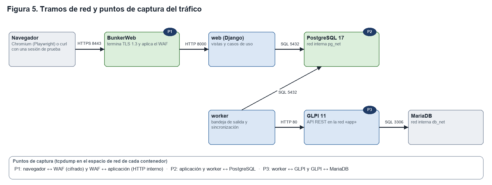

# Análisis de captura de tráfico de la aplicación web

**SSGUI · Sistema de Solicitud de Gestión de Usuarios Interno** · ANDINA S.A.S. (empresa ficticia; todos los datos son ficticios)
José Bedoya, Carlos Ruiz, Luis Cerón y Cristian Caro · Institución Universitaria Politécnico Grancolombiano · Taller de Desarrollo Seguro de Software · Grupo G01
Docente: José Eduardo Patiño Santafé · Entregable 3 de 4 · 25 de octubre de 2026

## 1. Objetivo y resumen

Este documento presenta el análisis del tráfico de red generado por la aplicación SSGUI durante la ejecución de seis casos de uso. El objetivo es comprobar, con capturas reales, que la información viaja cifrada donde debe hacerlo, que los campos restringidos (el motivo de un retiro y la descripción de una emergencia) no llegan a GLPI ni aparecen en claro fuera de los tramos previstos, que las credenciales hacia la base de datos no viajan legibles y que cada caso de uso produce exactamente las comunicaciones esperadas.

Las capturas se realizaron sobre la arquitectura de referencia del proyecto, que se ejecuta en la máquina local con Docker Desktop. Se capturó una vez por caso de uso, en tres puntos de la red, y cada captura se analizó con tshark mediante filtros reproducibles.

**Tabla 1. Resumen de resultados**

| Propiedad verificada | Esperado | Medido en los seis casos | Resultado |
|---|---|---|---|
| Cifrado del tramo navegador–WAF | TLS 1.3 con una suite de cifrado autenticado | 16 de 16 negociaciones en TLS 1.3, todas con TLS_AES_256_GCM_SHA384 | Cumple |
| Campo restringido hacia GLPI | 0 tramas | 0 tramas en 46 156 capturadas en GLPI | Cumple |
| Campo restringido en el tramo cifrado | 0 tramas legibles | 0 | Cumple |
| Contraseñas hacia PostgreSQL | Ninguna en claro | 59 autenticaciones SCRAM y 0 contraseñas en claro | Cumple |
| Transacciones en la base de datos | Toda transacción abierta se confirma | 294 inicios y 294 confirmaciones | Cumple |
| Tokens de la API de GLPI | No legibles en la red | 626 App-Token y 622 Session-Token legibles en la red interna | No cumple (hallazgo B-32) |
| Tramo GLPI–MariaDB | Cifrado | 0 tramas cifradas de 43 150 | No cumple (hallazgo B-30) |

## 2. Metodología

### 2.1 Puntos de captura

La captura se realizó con tcpdump, desde una imagen de herramientas de red fijada por su resumen criptográfico (nicolaka/netshoot, b09d9b21), adosada al espacio de red de cada contenedor. Esta técnica permite observar el tráfico tal como lo ve cada servicio, sin modificar su configuración. La Figura 5 muestra los tramos de red y los tres puntos de captura.



**Tabla 2. Puntos de captura y tramos observados**

| Punto | Contenedor | Tramos observados | Filtro de captura |
|---|---|---|---|
| P1 | bunkerweb | Navegador ↔ WAF (HTTPS, puerto interno 8443, publicado como 443) y WAF ↔ aplicación (HTTP, puerto 8000) | port 8443 or port 8080 or port 8000 |
| P2 | postgres | Aplicación y trabajador ↔ PostgreSQL (puerto 5432) | port 5432 |
| P3 | glpi | Trabajador ↔ API de GLPI (puerto 80) y GLPI ↔ MariaDB (puerto 3306) | port 80 or port 3306 |

### 2.2 Casos de uso capturados

Los códigos de caso de uso corresponden al catálogo del entregable 1.

**Tabla 3. Casos de uso y forma de ejecución**

| Caso | Actor | Ejecución |
|---|---|---|
| CU-06 Emitir un ingreso con soporte de vinculación | RRHH | Navegador real (Chromium mediante Playwright) a través del WAF, con un PDF de prueba |
| CU-02 y CU-05 Registrar y aprobar vacaciones | Colaborador y RRHH | Navegador real a través del WAF: registro por el colaborador y aprobación en la bandeja de RRHH |
| CU-07 Emitir un retiro con motivo restringido | RRHH | Navegador real a través del WAF, con un valor centinela en el motivo |
| CU-08 Emitir una emergencia | RRHH | Navegador real a través del WAF, con un valor centinela en la descripción |
| CU-09 Consultar panel, cuentas y ficha | Técnico | Peticiones HTTPS a través del WAF con una sesión de prueba |
| CU-11 Consultar y verificar la auditoría | Auditor | Consulta y verificación de la cadena (formulario con protección CSRF) a través del WAF |

### 2.3 Procedimiento

1. **Neutralización.** Antes de las capturas se respaldó la base de datos, se levantaron los bloqueos del WAF y se eliminaron de la instancia desechable de GLPI los tickets de corridas anteriores, de modo que cada caso creara tickets nuevos (hallazgo B-37).
2. **Captura por caso.** Para cada caso se iniciaron las tres capturas, se ejecutó el caso y se esperó un ciclo completo de la bandeja de salida (30 segundos) antes de detenerlas.
3. **Valores centinela.** En los campos restringidos se escribieron valores que no existen en ningún otro dato («CENTINELA-…»). Su presencia fuera de los tramos previstos constituiría una fuga.
4. **Análisis.** Cada captura se analizó con tshark mediante filtros de visualización: versión y suite de TLS, peticiones y respuestas HTTP, presencia del centinela, autenticación y transacciones de PostgreSQL, creación de tickets y tokens en las cabeceras.
5. **Restauración.** Al terminar se restauró la base de datos (las filas regresaron a 414/21/88/75) y se eliminaron los tickets de prueba de GLPI (20 tickets).

**Control positivo.** Una captura que no ve nada no prueba nada. Por ello, cada afirmación de ausencia (cero tramas con el centinela hacia GLPI) se acompaña de una presencia donde el valor sí debe estar: en el tramo interno WAF–aplicación y en la base de datos.

**Tratamiento de la evidencia.** Los archivos de captura (.pcap) no se incorporan al repositorio, porque contienen tokens y valores centinela. Se conservan el comando exacto, la salida del análisis con los secretos enmascarados, la versión de las herramientas, el commit y la fecha.

## 3. Resultados por caso de uso

### 3.1 CU-06 Emitir un ingreso con soporte de vinculación

**Tabla 4. Tráfico del ingreso**

| Medida | Valor |
|---|---|
| Tramas en P1, P2 y P3 | 458, 971 y 5 444 |
| Negociaciones TLS | 2, en TLS 1.3 con TLS_AES_256_GCM_SHA384 |
| Peticiones del WAF a la aplicación | GET del formulario, GET de la hoja de estilos, envío del formulario (1,49 MB) y GET del listado de solicitudes |
| Respuestas de la aplicación | 3 respuestas 200 y 1 redirección 302 tras el envío |
| Transacciones en la base de datos | 30 inicios y 30 confirmaciones; 13 autenticaciones SCRAM |
| Escrituras del trabajador en GLPI | Creación del usuario del colaborador, creación de tickets, 4 actualizaciones de tickets y 2 vínculos del documento (a AD y a Licencias) |

El envío del formulario multiparte con el PDF aparece como una conversación TCP de 1,49 MB entre el WAF y la aplicación, seguida de la redirección 302. Tshark no lo reconoce como petición HTTP porque la captura perdió segmentos de esa ráfaga (los marca como «ACKed unseen segment»); por la misma razón, de las cuatro creaciones de ticket del ingreso se reconocieron tres, y la eliminación final de los tickets de prueba confirmó que los cuatro existían en GLPI.

El documento no se volvió a subir: GLPI ya conservaba el mismo PDF de una corrida anterior, y el adaptador reutiliza un documento existente cuando coincide su resumen. El trabajador solo lo vinculó a los tickets de AD y de Licencias y lo descargó (1,69 MB) para verificar su resumen SHA-256 antes de borrar la copia local, como exige el diseño. El extracto siguiente, tomado de una repetición del mismo caso, muestra el tramo externo y el tramo interno del ingreso:

```
P1  4   10.20.40.132 → 10.20.40.2    Client Hello (SNI=app.localhost)
P1  6   10.20.40.2   → 10.20.40.132  Server Hello, Change Cipher Spec, Application Data
P1  32  10.20.40.2   → 10.20.40.129  GET /solicitudes/nueva/ING HTTP/1.1
P1  36  10.20.40.129 → 10.20.40.2    HTTP/1.1 200 OK (text/html)
P1  450 10.20.40.129 → 10.20.40.2    [TCP ACKed unseen segment] HTTP/1.1 302 Found
P1  461 10.20.40.2   → 10.20.40.129  GET /solicitudes HTTP/1.1
```

### 3.2 CU-02 y CU-05 Registrar y aprobar vacaciones

**Tabla 5. Tráfico de las vacaciones**

| Medida | Valor |
|---|---|
| Tramas en P1, P2 y P3 | 199, 1 771 y 12 022 |
| Negociaciones TLS | 4, en TLS 1.3 con TLS_AES_256_GCM_SHA384 (dos sesiones: colaborador y RRHH) |
| Peticiones del WAF a la aplicación | Formulario de vacaciones (GET y POST), listado de solicitudes, bandeja de RRHH (2 GET), aprobación (POST) y hoja de estilos |
| Respuestas de la aplicación | 6 respuestas 200 y 2 redirecciones 302 |
| Transacciones en la base de datos | 85 inicios y 85 confirmaciones; 17 autenticaciones SCRAM |
| Tickets creados en GLPI | 4: suspensión en AD y en Licencias y sus reactivaciones programadas |

La secuencia confirma la doble firma: la solicitud del colaborador no generó tickets hasta que RRHH la aprobó desde su bandeja.

### 3.3 CU-07 Emitir un retiro con motivo restringido

**Tabla 6. Tráfico del retiro**

| Medida | Valor |
|---|---|
| Tramas en P1, P2 y P3 | 96, 1 707 y 14 242 |
| Negociaciones TLS | 2, en TLS 1.3 con TLS_AES_256_GCM_SHA384 |
| Peticiones del WAF a la aplicación | Formulario de retiro (GET y POST), listado de solicitudes y hoja de estilos |
| Centinela del motivo | Tramo cifrado: 0 · tramo WAF–aplicación: 1 · base de datos: 34 · hacia GLPI: 0 |
| Transacciones en la base de datos | 77 inicios y 77 confirmaciones; 12 autenticaciones SCRAM |
| Tickets creados en GLPI | 6, incluidos los dos tickets posteriores de eliminación a 90 días |

El motivo aparece en el tramo interno WAF–aplicación, porque el WAF termina la sesión TLS y reenvía el cuerpo del formulario, y en la base de datos, donde se almacena en la tabla restringida. Esa presencia es el control positivo. En ninguna de las 14 242 tramas capturadas en GLPI aparece el motivo: los tickets llevan únicamente datos técnicos.

### 3.4 CU-08 Emitir una emergencia

**Tabla 7. Tráfico de la emergencia**

| Medida | Valor |
|---|---|
| Tramas en P1, P2 y P3 | 92, 1 757 y 14 316 |
| Negociaciones TLS | 2, en TLS 1.3 con TLS_AES_256_GCM_SHA384 |
| Peticiones del WAF a la aplicación | Formulario de emergencia (GET y POST), listado de solicitudes y hoja de estilos |
| Centinela de la descripción | Tramo cifrado: 0 · tramo WAF–aplicación: 1 · base de datos: 36 · hacia GLPI: 0 |
| Transacciones en la base de datos | 78 inicios y 78 confirmaciones; 11 autenticaciones SCRAM |
| Tickets creados en GLPI | 6, con prioridad «Muy alta» y vencimiento de una hora |

### 3.5 CU-09 Consultar panel, cuentas y ficha

**Tabla 8. Tráfico de la consulta técnica**

| Medida | Valor |
|---|---|
| Tramas en P1, P2 y P3 | 109, 190 y 66 |
| Negociaciones TLS | 3, en TLS 1.3 con TLS_AES_256_GCM_SHA384 |
| Peticiones y respuestas | GET del panel, de la búsqueda de cuentas y de la ficha de un colaborador: 3 respuestas 200 |
| Centinela | 0 en todos los tramos, incluida la base de datos |
| Transacciones en la base de datos | 10 inicios y 10 confirmaciones |
| Tráfico hacia GLPI | 1 consulta de salud del trabajador; ninguna escritura |

El panel y la ficha se construyen solo con la base de datos de la aplicación: la web no consulta GLPI durante una petición, conforme al diseño (el trabajador es el único cliente de GLPI). Que el centinela no aparezca ni siquiera en la base de datos indica que las consultas de los técnicos no leen la tabla restringida.

### 3.6 CU-11 Consultar y verificar la auditoría

**Tabla 9. Tráfico de la auditoría**

| Medida | Valor |
|---|---|
| Tramas en P1, P2 y P3 | 132, 233 y 66 |
| Negociaciones TLS | 3, en TLS 1.3 con TLS_AES_256_GCM_SHA384 |
| Peticiones y respuestas | 2 GET y 1 POST de verificación a /auditoria: 3 respuestas 200; la respuesta confirma que la cadena está íntegra |
| Centinela | 0 en todos los tramos |
| Transacciones en la base de datos | 14 inicios y 14 confirmaciones |

La verificación es un formulario protegido contra falsificación de peticiones (CSRF). En una primera ejecución con curl, la petición se rechazó con el código 403 porque la cabecera Referer incluía el puerto interno del WAF, que no forma parte de los orígenes de confianza; corregida la cabecera, la verificación respondió 200. El rechazo inicial confirma que la protección CSRF está activa.

## 4. Análisis consolidado por tramo

**Tabla 10. Consolidado de los seis casos de uso**

| Tramo | Tramas | Cifrado | Hallazgo principal |
|---|---|---|---|
| Navegador ↔ WAF | 1 086 en P1 (ambos tramos) | Sí, TLS 1.3 | 16 negociaciones, todas con TLS_AES_256_GCM_SHA384; el centinela nunca aparece legible |
| WAF ↔ aplicación | Incluido en P1 | No (red interna «app») | El centinela aparece en el envío del formulario, como se espera al terminar TLS en el borde |
| Aplicación y trabajador ↔ PostgreSQL | 6 629 | No (red interna pg_net) | 59 autenticaciones SCRAM, 0 contraseñas en claro; 294 transacciones abiertas y confirmadas |
| Trabajador ↔ GLPI | Incluido en P3 | No (red «app») | Tokens de la API legibles en cada petición (B-32); 0 tramas con el centinela |
| GLPI ↔ MariaDB | 43 150 | No (red interna db_net) | Consultas legibles (B-30) |

### 4.1 Aspectos conformes

- **Cifrado externo.** Todo el tráfico desde el navegador viaja en TLS 1.3 con una suite de cifrado autenticado. El certificado es autofirmado, lo cual es coherente con una arquitectura sin exposición pública.
- **Aislamiento de los campos restringidos.** El centinela no apareció en ninguna de las 46 156 tramas capturadas en GLPI ni en claro en el tramo cifrado.
- **Autenticación hacia la base de datos.** Todas las conexiones usaron SCRAM; ninguna contraseña viajó en claro.
- **Coherencia transaccional.** Cada transacción iniciada se confirmó; no quedaron transacciones abiertas.
- **Cabeceras y cookies.** En las capturas del tramo interno realizadas durante la auditoría se observaron las cookies de sesión con los atributos Secure, HttpOnly y SameSite=Lax, y las cabeceras de seguridad emitidas por la aplicación.
- **Comunicaciones esperadas.** Cada caso de uso generó exactamente las peticiones de su flujo, y solo los casos que emiten solicitudes produjeron escrituras hacia GLPI.

### 4.2 Debilidades identificadas

- **Tokens de la API de GLPI legibles (B-32, severidad media).** Cada petición del trabajador a GLPI lleva App-Token y Session-Token en claro: 626 y 622 apariciones en los seis casos. Un contenedor comprometido que comparta la red «app» podría leerlos y actuar con los permisos de la cuenta de servicio. El extracto siguiente muestra la forma de esas cabeceras, con los valores enmascarados:

```
POST /apirest.php/User HTTP/1.1
Host: glpi
User-Agent: python-httpx/0.28.1
App-Token: ****************************************
Session-Token: ****************************************
Content-Type: application/json
```

- **Tramo GLPI–MariaDB sin cifrar (B-30, severidad baja).** Las consultas de GLPI a su base de datos son legibles; la red es interna y solo la comparten esos dos contenedores.
- **Campo restringido en el texto SQL.** La aplicación enlaza los parámetros de las consultas del lado del cliente, de modo que el valor del campo restringido viaja dentro del texto de la consulta hacia PostgreSQL. No existe inyección, porque el controlador escapa cada valor, pero si la base registrara sentencias, el valor quedaría en esos registros.
- **Campo restringido en el tramo WAF–aplicación.** Es consecuencia de terminar TLS en el borde; el límite de confianza es el equipo y la red interna.

## 5. Relación con los controles propuestos

**Tabla 11. Controles verificados mediante el análisis de tráfico**

| Control (entregable 4) | Evidencia en las capturas |
|---|---|
| C-01 Cifrado en tránsito | 16 negociaciones en TLS 1.3 con suite de cifrado autenticado |
| C-07 Aislamiento de campos restringidos | 0 apariciones del centinela hacia GLPI y en el tramo cifrado; presencia solo en el tramo interno y en la base de datos |
| C-10 Roles de base de datos | Autenticación SCRAM; conexiones solo dentro de la red interna pg_net |
| C-13 Aislamiento de red | El tráfico de la base y de MariaDB se observa solo en sus redes internas |
| C-14 Cuenta de servicio acotada | Solo el trabajador escribe en GLPI; la web no consulta GLPI durante una petición |

Las mejoras propuestas para las debilidades encontradas son la red dedicada entre el trabajador y GLPI (P-1), el perfil de servicio sin permisos de borrado (P-11) y el enlace de parámetros en el servidor; se detallan en la sección 10 del entregable 4.

## 6. Limitaciones

1. Las capturas se realizaron dentro del equipo, en el espacio de red de los contenedores. La arquitectura no tiene exposición pública, de modo que no existe un tramo de internet que capturar.
2. En ráfagas grandes (el envío de un PDF), tcpdump perdió segmentos y tshark no reconoció algunas peticiones como HTTP. Se identificaron por la conversación TCP y se confirmaron por sus efectos (la redirección y los tickets presentes en GLPI).
3. El tramo hacia Supabase Auth no se capturó: el recorrido con navegador usa sesiones de prueba equivalentes a una sesión con segundo factor verificado, y Supabase es un servicio de terceros.
4. Los cambios de departamento y de sucursal no se capturaron por separado; su tráfico es análogo al de las vacaciones y se verifica con la suite automatizada.

## 7. Conclusiones

1. El tráfico de las personas usuarias viaja cifrado con TLS 1.3 y una suite de cifrado autenticado en todos los casos de uso.
2. Los campos restringidos no salen de los tramos previstos: no llegan a GLPI ni aparecen legibles en el tramo cifrado, lo que confirma de manera independiente el control de confidencialidad C-07.
3. La comunicación con la base de datos autentica con SCRAM y mantiene la coherencia transaccional.
4. La principal debilidad es de red interna: los tokens de la API de GLPI viajan legibles entre el trabajador y GLPI (B-32). La medida propuesta, una red dedicada solo para esos dos contenedores, es de bajo esfuerzo.
5. Cada caso de uso produce únicamente las comunicaciones de su flujo, lo que respalda la separación de responsabilidades del diseño: la web atiende a las personas usuarias y el trabajador es el único cliente de GLPI.

## 8. Reproducibilidad

Las capturas se repiten con el comando `JML_GLPI_DE_PRUEBAS=si bash auditoria/scripts/captura-por-caso-de-uso.sh`, que neutraliza el entorno, captura cada caso, analiza las capturas y restaura el estado. La salida completa de la corrida que sustenta este documento está en la evidencia `trafico/DS-TRAFICO-POR-CASO-DE-USO`, junto con el comando, la versión de las herramientas, el commit y la fecha. Las corridas anteriores, con sus problemas documentados, se conservan como `DS-TRAFICO-POR-CASO-DE-USO-CORRIDA1-TICKETS-REPETIDOS` y `DS-TRAFICO-POR-CASO-DE-USO-CORRIDA2-CSRF-403`.
