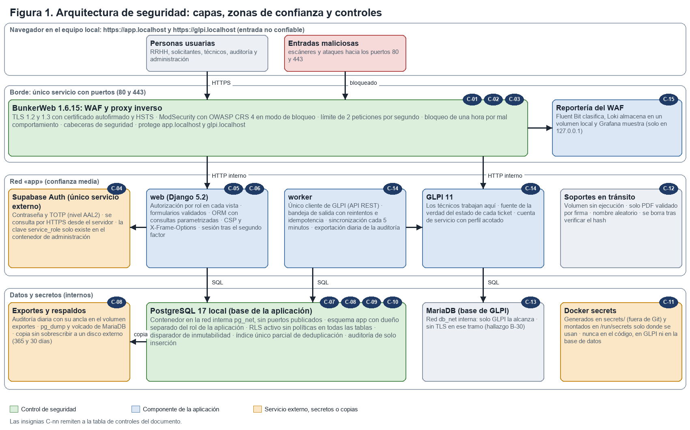
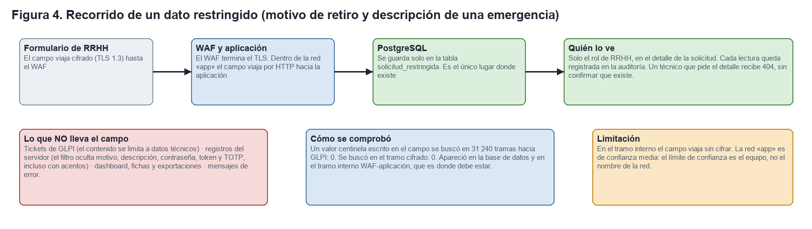
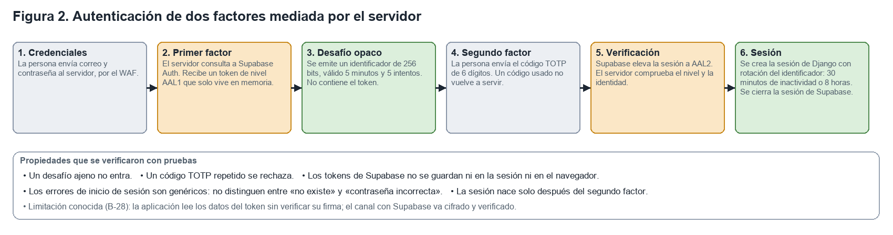
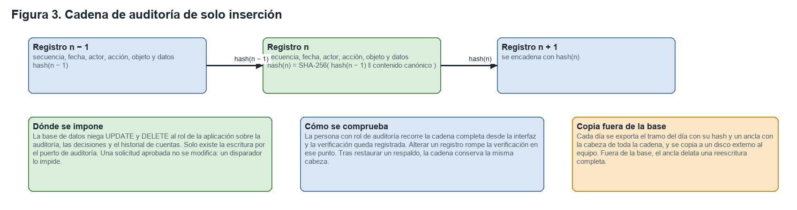

# Propuesta de controles de seguridad de la información

**SSGUI · Sistema de Solicitud de Gestión de Usuarios Interno** · ANDINA S.A.S. (empresa ficticia; todos los datos son ficticios)
José Bedoya, Carlos Ruiz, Luis Cerón y Cristian Caro · Institución Universitaria Politécnico Grancolombiano · Taller de Desarrollo Seguro de Software · Grupo G01
Docente: José Eduardo Patiño Santafé · Entregable 4 de 4 · 25 de octubre de 2026

## 1. Introducción y alcance

Este documento describe la propuesta de controles de seguridad de la información del sistema SSGUI en términos de **confidencialidad**, **autenticidad** e **integridad**, e ilustra la arquitectura de seguridad que los sustenta. La propuesta no es solo un diseño: cada control se implementó y se sometió a pruebas, y las secciones 4 a 7 indican el resultado de su verificación y las limitaciones que se identificaron.

El sistema formaliza la interacción entre Recursos Humanos y Tecnología durante el ciclo de vida laboral de los colaboradores (ingreso, vacaciones, cambio de departamento o sucursal, retiro y emergencia). La aplicación registra y aprueba cada evento y genera un ticket por cola de atención en GLPI 11, donde el personal técnico ejecuta las acciones. Una decisión de diseño condiciona toda la propuesta: la aplicación **no ejecuta acciones sobre directorios ni servicios de identidad**; las acciones técnicas las realizan personas y quedan documentadas en la solución del ticket.

La arquitectura de referencia es la definida en la primera entrega: **todo el sistema se ejecuta en la máquina local del equipo con Docker Desktop**. La base de datos de la aplicación es PostgreSQL 17 en contenedor, GLPI conserva su propia MariaDB y el único servicio externo es Supabase Auth, que se utiliza exclusivamente para la autenticación. No existe exposición pública: no se usan dominio, certificados públicos ni servicios de nube para el cómputo.

## 2. Arquitectura de seguridad propuesta

### 2.1 Visión general

La Figura 1 presenta la arquitectura por capas. El diseño aplica defensa en profundidad: el tráfico de las personas usuarias atraviesa un único borde protegido, la aplicación valida y autoriza cada operación, los datos se protegen en el motor de base de datos, los secretos no residen en el código ni en la base de datos y las copias de la auditoría y de los respaldos se conservan fuera del equipo.

### 2.2 Componentes de despliegue

**Tabla 1. Contenedores y su función de seguridad**

| Contenedor | Imagen | Redes | Función de seguridad |
|---|---|---|---|
| bunkerweb y bw-scheduler | BunkerWeb 1.6.15, fijada por resumen criptográfico | bw-universe, app | Único servicio que publica puertos (80 y 443); TLS con certificado autofirmado, WAF, límites de frecuencia y cabeceras |
| web | python:3.12-slim con Django 5.2 LTS y gunicorn | app, pg_net | Autenticación, autorización por rol, validación de entradas y casos de uso |
| worker | La misma imagen que web | app, pg_net | Único cliente de GLPI; bandeja de salida idempotente, sincronización y exportación diaria de la auditoría |
| glpi | GLPI 11.0.11 | app, db_net | Mesa de servicio donde trabajan los técnicos |
| mariadb | MariaDB 11.4 | db_net (interna) | Base de datos de GLPI, sin puertos publicados |
| postgres | PostgreSQL 17 | pg_net (interna) | Base de datos de la aplicación, sin puertos publicados |
| Reportería (opcional) | Fluent Bit, Loki y Grafana | waf-logs | Clasificación y consulta de los registros del WAF, solo en 127.0.0.1 |

### 2.3 Principios de diseño

| Principio | Aplicación en el sistema |
|---|---|
| Defensa en profundidad | Cada propiedad se protege en más de una capa; por ejemplo, la inyección SQL se contiene con el WAF, con el ORM y con roles de base de datos sin privilegios de modificación del esquema |
| Mínimo privilegio | El rol de la aplicación no es propietario de ningún objeto y no modifica la auditoría; la clave de administración de Supabase solo existe en el contenedor de administración; la cuenta de servicio de GLPI tiene un perfil acotado |
| Seguridad por diseño | Las reglas de negocio residen en un dominio puro, sin dependencias externas; los adaptadores dependen hacia el interior y un verificador de arquitectura impide invertir esa dirección |
| Garantías en el motor, no solo en el código | La deduplicación, la inmutabilidad de una solicitud aprobada y el carácter de solo inserción de la auditoría los impone la base de datos |
| Ausencia de confianza implícita | Las cabeceras HTTP se consideran entradas no confiables; las redes internas se tratan como zonas de confianza media |
| Verificación por refutación | Un control se considera verificado solo si una prueba falla al retirarlo (defecto sembrado) o si una medición independiente lo confirma |

### 2.4 Zonas de confianza

| Zona | Componentes | Nivel de confianza | Controles principales |
|---|---|---|---|
| Navegador | Personas usuarias, escáneres y cualquier entrada que llegue a los puertos 80 y 443 del equipo | Ninguno | Todo el tráfico se trata como no confiable |
| Borde | BunkerWeb (WAF y proxy inverso) | Control propio | TLS, ModSecurity con OWASP CRS, límites de frecuencia, cabeceras de seguridad |
| Red «app» | Aplicación web, trabajador de integración, GLPI y soportes en tránsito | Media | Autorización por rol, validación de entradas, cuenta de servicio acotada |
| Datos y secretos | PostgreSQL, MariaDB y Docker secrets | Alta, en redes internas sin puertos publicados | Roles mínimos, seguridad por filas, disparadores, redes internas |
| Servicio externo | Supabase Auth | Tercero | HTTPS con verificación del certificado, segundo factor, clave de administración aislada |
| Medio externo | Disco externo con la auditoría exportada y los respaldos | Alta, fuera del equipo | Copia sin sobrescribir; ancla de la cadena de auditoría |

## 3. Modelo de amenazas y objetivos de seguridad

Se utilizó el modelo STRIDE con 26 amenazas identificadas (T1 a T21 del documento de requisitos y N-1 a N-5 incorporadas durante la auditoría). La Tabla 2 relaciona cada categoría con la propiedad de seguridad afectada y con los controles que la mitigan; el catálogo completo de controles figura en la sección 8.

**Tabla 2. Relación entre amenazas, propiedades y controles**

| Categoría STRIDE | Ejemplo en el sistema | Propiedad | Controles |
|---|---|---|---|
| Suplantación (Spoofing) | Acceso con credenciales robadas; reutilización de un código TOTP | Autenticidad | C-04, C-05 |
| Manipulación (Tampering) | Modificar una solicitud aprobada o un registro de auditoría | Integridad | C-06, C-08, C-09 |
| Repudio (Repudiation) | Negar una decisión de aprobación o una acción técnica | Integridad y trazabilidad | C-08, C-15 |
| Divulgación de información | Exposición del motivo de un retiro; conexión directa a la base de datos desde fuera de los contenedores | Confidencialidad | C-01, C-07, C-10, C-11, C-13 |
| Denegación de servicio | Saturación del sistema o caída de GLPI, de PostgreSQL o del proyecto de Supabase Auth | Disponibilidad | C-03, C-13 |
| Elevación de privilegios | Acceso a una vista de otro rol; uso excesivo de la cuenta de servicio | Autenticidad y confidencialidad | C-05, C-10, C-14 |

## 4. Controles de confidencialidad

La confidencialidad exige que la información sensible solo sea accesible para quien tiene autorización. En este sistema la información de mayor sensibilidad es el **motivo de un retiro** y la **descripción de una emergencia**, a los que se denomina campos restringidos.

**Tabla 3. Controles de confidencialidad**

| Control | Descripción | Verificación |
|---|---|---|
| C-01 Cifrado en tránsito | El borde admite únicamente TLS 1.2 y 1.3 con suites de cifrado autenticado y HSTS de un año, con un certificado autofirmado para app.localhost y glpi.localhost; el puerto 80 solo redirige a 443 | testssl.sh: sin vulnerabilidades; 10 de 10 negociaciones en TLS 1.3; redirección 301 medida |
| C-07 Aislamiento de campos restringidos | Los campos restringidos se almacenan solo en la tabla solicitud_restringida y nunca se envían a GLPI, a los registros, al panel, a las fichas ni a las exportaciones. Un técnico que solicita el detalle recibe 404, sin confirmar su existencia | Un valor centinela buscado en 31 240 tramas hacia GLPI: 0 apariciones; en el tramo cifrado: 0 |
| C-10 Roles de base de datos y seguridad por filas | La base vive en el contenedor postgres, dentro de la red interna pg_net y sin puertos publicados. El rol de la aplicación no puede modificar el esquema; la seguridad por filas está activa sin políticas en todas las tablas y los roles anon y authenticated no reciben privilegios | 15 pruebas con cambio de rol; medición en la base local: 0 privilegios para anon y authenticated, seguridad por filas en todas las tablas y ningún puerto publicado |
| C-11 Gestión de secretos | Los secretos se generan en el directorio secrets/ del equipo, que no se versiona, y Docker Compose los monta como archivos en /run/secrets solo en los contenedores que los necesitan. Nunca residen en el código, en GLPI ni en la base de datos; los que el equipo comparte se versionan cifrados con SOPS y age, y un gancho previo al commit rechaza secretos | gitleaks: 0 hallazgos en el historial y en la entrega; la clave de administración de Supabase no está en web ni en worker |
| C-12 Soportes de vinculación | Solo se aceptan PDF validados por su firma de contenido y con un máximo de 20 MB, con nombre aleatorio, en un volumen en memoria montado sin ejecución (noexec, nosuid, nodev); la aplicación nunca los abre ni los sirve | Pruebas con PDF falsificados, de 20 MB exactos y con nombres maliciosos; opciones de montaje medidas en los contenedores (hallazgo B-38, corregido) |
| C-15 Registro con filtrado | Los registros estructurados ocultan contraseñas, tokens, códigos, motivo y descripción, incluso con tildes | Propiedad probada con 1 000 casos; defecto sembrado detectado |

**Limitaciones de confidencialidad.** El campo restringido viaja sin cifrar entre el WAF y la aplicación, dentro de la red «app» (la zona de confianza media): el WAF termina la sesión TLS. Además, los tokens de la API de GLPI viajan sin cifrar entre el trabajador y GLPI (382 peticiones observadas; hallazgo B-32), y Django enlaza los parámetros SQL del lado del cliente, de modo que el valor del campo viaja dentro del texto de la consulta. Un PDF malicioso que cumpla la firma de contenido sería aceptado, porque el sistema no incluye antivirus por decisión de diseño (hallazgo B-22).

## 5. Controles de autenticidad

La autenticidad exige verificar la identidad de quien actúa y que la acción corresponde a su rol.

**Tabla 4. Controles de autenticidad**

| Control | Descripción | Verificación |
|---|---|---|
| C-04 Doble factor de autenticación | La sesión se crea únicamente después de verificar un código TOTP (nivel AAL2) con Supabase Auth, mediado por el servidor. Los tokens de Supabase no se almacenan; los errores de inicio de sesión son genéricos; un código usado no se acepta de nuevo; el desafío intermedio expira a los 5 minutos y a los 5 intentos | 110 pruebas; defecto sembrado «segundo uso del código» detectado |
| C-05 Autorización por rol | Cada vista verifica el rol del usuario; los roles incompatibles se rechazan; una persona de RRHH no aprueba solicitudes propias; el detalle de una solicitud ajena responde como inexistente | Matriz de 440 celdas (22 rutas, 2 métodos y 10 roles): 0 resultados distintos del esperado |
| Control de sesión | Rotación del identificador al iniciar; cierre a los 30 minutos de inactividad o a las 8 horas; cookies con Secure, HttpOnly y SameSite=Lax | Pruebas de ingreso y captura de tráfico |
| Segregación de funciones | Registro y aprobación por personas distintas; doble firma entre quien solicita y RRHH; la persona administradora no aprueba | Pruebas de dominio y de aplicación |
| C-14 Cuenta de servicio acotada | El trabajador es el único cliente de GLPI y usa un perfil con permisos limitados a tickets, documentos, usuarios y lectura de activos | Perfil medido: incluye además borrar y purgar tickets (hallazgo B-35) |

**Limitaciones de autenticidad.** La aplicación lee los datos del token de Supabase sin verificar su firma ni su expiración (hallazgo B-28); el riesgo se acota porque el token llega por HTTPS, con verificación del certificado, en respuesta a una solicitud del propio servidor. La política mínima de contraseña de Supabase depende de una configuración manual en su panel (hallazgo B-10). El rol de auditoría no puede leer solicitudes, a diferencia de lo previsto (hallazgo B-26).

## 6. Controles de integridad

La integridad exige que la información no se altere de forma no autorizada o inadvertida, y que cualquier alteración sea detectable.

**Tabla 5. Controles de integridad**

| Control | Descripción | Verificación |
|---|---|---|
| C-08 Auditoría encadenada | Cada registro incluye el resumen SHA-256 del anterior; la base de datos niega la modificación y la eliminación al rol de la aplicación; el Auditor recorre la cadena desde la interfaz; cada día se exporta el tramo con un ancla de la cabeza al volumen exportes, y de allí a un disco externo sin sobrescribir | Cadena válida tras restaurar (secuencia 414) y tras una carga de 6 586 registros; alterar un registro rompe la verificación |
| C-09 Inmutabilidad y deduplicación en la base | Un disparador impide modificar una solicitud aprobada y las transiciones inválidas; un índice único parcial impide dos solicitudes abiertas del mismo tipo para la misma persona | Defecto sembrado «sin disparador» detectado; dos conexiones concurrentes: gana una |
| C-06 Validación de entradas | Formularios de Django para toda entrada; consultas únicamente con el ORM o con parámetros; plantillas con escape automático; política de seguridad de contenido y X-Frame-Options | sqlmap hasta nivel 5: 0 inyecciones; ZAP: 0 alertas FAIL |
| Bandeja de salida idempotente | La creación de tickets usa una bandeja con reintentos y claves de idempotencia, de modo que una caída de GLPI no pierde ni duplica tickets | Pruebas de resiliencia y pruebas contra GLPI 11 real (30 de 30) |
| Derivación de cuentas | El estado de una cuenta solo cambia con la sincronización de tickets resueltos con solución; ningún comando ni vista lo edita | Pruebas de resolución y de sincronización |
| C-16 Cadena de suministro | Dependencias y imágenes fijadas por resumen criptográfico; escaneo de dependencias, de imágenes y de secretos; verificador de arquitectura | pip-audit: 0; imagen propia: 0 críticas; 0 de 139 CVE en KEV |

**Limitaciones de integridad.** Quitar los últimos registros de la cadena no se detecta con la cadena sola; para ello existe la copia exportada con su ancla. En la máquina local esa copia no reside en un almacenamiento inmutable: la integridad se sustenta en la cadena de hashes y en el ancla diaria copiada fuera del equipo, lo que constituye un riesgo residual aceptado. La copia diaria al disco externo se verificó con una carpeta que hace las veces del disco: copia idempotente comprobada por SHA-256, alarma sin sobrescribir cuando una copia fue alterada, retención de 30 días para los respaldos y restauración completa en 23 segundos. Falta programarla en el equipo de operación con el disco externo real.

## 7. Controles complementarios de disponibilidad y borde

Aunque la propuesta se centra en las tres propiedades solicitadas, se incluyen los controles que protegen la disponibilidad y reducen la superficie de ataque, porque condicionan a los anteriores.

**Tabla 6. Controles complementarios**

| Control | Descripción | Verificación |
|---|---|---|
| C-02 Cortafuegos de aplicaciones web | ModSecurity con el conjunto OWASP CRS 4 en modo de bloqueo, sin exclusiones | Tráfico normal 200 y siete ataques 403 en los dos dominios |
| C-03 Límites de frecuencia y bloqueo | 2 peticiones por segundo, 5 por minuto en el inicio de sesión, y bloqueo de una hora por mal comportamiento | Medido; se identificó que puede bloquear a una persona legítima (hallazgo B-36) |
| C-13 Aislamiento de red | Solo el WAF publica puertos en el equipo; las redes de datos pg_net y db_net son internas y sin salida; la reportería escucha solo en 127.0.0.1 | Matriz de puertos: 28 comprobaciones sin diferencias |
| Detección y recuperación | Comprobaciones de salud; respaldo con pg_dump y volcado de MariaDB; restauración en un contenedor PostgreSQL 17 limpio con la cadena íntegra | Detección en 63 s (GLPI) y 43 s (base); restauración en 19 s frente a un objetivo de 4 horas |
| Rendimiento | Páginas con percentil 95 inferior a 800 ms y el panel inferior a 2 s | 466 a 649 ms por página; 786 ms el panel |

**Riesgos residuales de la arquitectura local.** La disponibilidad depende de un solo equipo: si la máquina se apaga o falla, el sistema no está disponible; se mitiga con la guía de instalación reproducible y con los respaldos fuera del equipo. Además, el plan gratuito de Supabase pausa los proyectos inactivos, por lo que antes de cada demostración se verifica que el proyecto de autenticación esté activo.

## 8. Catálogo de controles

**Tabla 7. Catálogo de controles de seguridad**

| Código | Control | Propiedad principal |
|---|---|---|
| C-01 | Cifrado en tránsito y HSTS en el borde | Confidencialidad |
| C-02 | Cortafuegos de aplicaciones web con OWASP CRS | Integridad y disponibilidad |
| C-03 | Límites de frecuencia y bloqueo por mal comportamiento | Disponibilidad |
| C-04 | Doble factor de autenticación mediado por el servidor | Autenticidad |
| C-05 | Autorización por rol en cada vista | Autenticidad |
| C-06 | Validación de entradas, consultas parametrizadas y política de contenido | Integridad |
| C-07 | Aislamiento de los campos restringidos | Confidencialidad |
| C-08 | Auditoría encadenada de solo inserción con copia fuera del equipo | Integridad |
| C-09 | Inmutabilidad y deduplicación impuestas por la base de datos | Integridad |
| C-10 | Base de datos local aislada, roles de mínimo privilegio y seguridad por filas | Confidencialidad |
| C-11 | Gestión de secretos con Docker secrets fuera del repositorio | Confidencialidad |
| C-12 | Validación y aislamiento de los soportes de vinculación | Confidencialidad e integridad |
| C-13 | Aislamiento de red: un único borde y redes internas | Confidencialidad y disponibilidad |
| C-14 | Cuenta de servicio acotada y un único cliente de GLPI | Autenticidad |
| C-15 | Registro estructurado con filtrado y reportería del WAF | Integridad y trazabilidad |
| C-16 | Control de la cadena de suministro | Integridad |

## 9. Verificación de la propuesta

La eficacia de los controles se evaluó con cuatro tipos de evidencia:

1. **Pruebas automáticas.** 2 574 pruebas pasan; la cobertura de ramas es de 97,7 % en el dominio, 94,8 % en la aplicación y 100 % en los siete módulos de seguridad.
2. **Mutación.** Se alteró el código de forma controlada para comprobar que las pruebas detectan el cambio: 97,8 % en el dominio, 92,7 % en la aplicación y 96,1 % en los módulos de seguridad.
3. **Defectos sembrados.** Se retiró deliberadamente un control a la vez y se comprobó que alguna prueba fallara: los seis defectos (consulta construida por formato, ausencia del permiso de solo inserción, disparador apagado, rol omitido, PDF renombrado y segundo uso del código TOTP) fueron detectados.
4. **Mediciones independientes.** Escaneo activo (ZAP y sqlmap), análisis de tráfico, escaneo de imágenes e inspección de privilegios y puertos en la base de datos local.

El puntaje global de riesgo residual es 1,3 sobre 100 (clasificado como aceptable), calculado sobre 147 controles verificados de la norma OWASP ASVS 5.0. No hay hallazgos críticos ni altos.

## 10. Controles adicionales propuestos

La auditoría identificó mejoras que no están implementadas; se proponen en orden de prioridad y quedan sujetas a la decisión del equipo mediante un registro de decisión de arquitectura (ADR).

**Tabla 8. Controles adicionales propuestos**

| Prioridad | Propuesta | Hallazgo | Beneficio | Esfuerzo |
|---|---|---|---|---|
| 1 | P-12. El límite de frecuencia responde 429 sin activar el bloqueo de una hora | B-36 | Evita bloquear a una persona legítima, en particular durante una emergencia | 1 h |
| 2 | P-1. Red dedicada exclusiva entre el trabajador y GLPI | B-32 | Elimina la exposición de los tokens de GLPI a los demás contenedores | 3 h |
| 3 | P-11. Perfil de servicio de GLPI sin permisos de borrado ni purga | B-35 | Impide que un token comprometido destruya tickets | 1,5 h |
| 4 | Programar en el equipo de operación las tareas diarias de copia y respaldo hacia el disco externo real | Sección 6 | Hace efectiva la protección de la cadena fuera del equipo | 0,5 h |
| 5 | P-5. Verificación de firma, expiración y emisor del token de Supabase | B-28 | Completa la verificación de autenticidad | 3 h |
| 6 | P-8. Vista de solo lectura de solicitudes para el rol de auditoría | B-26 | Permite contrastar la cadena con la solicitud que describe | 3 h |
| 7 | P-2. Revisión mensual de las imágenes de terceros y escaneo nocturno | B-31, B-18 | Reduce la acumulación de vulnerabilidades | 2 h |
| 8 | Enlace de parámetros SQL en el servidor | Sección 4 | Evita que el valor de un campo restringido viaje dentro del texto de la consulta | A evaluar |
| 9 | Endurecimiento de contenedores: sistema de archivos de solo lectura y límites de procesos y de CPU | B-33 | Reduce el impacto de un contenedor comprometido | 3 h |

## 11. Conclusiones

1. La arquitectura propuesta, desplegada en la máquina local con Docker Desktop, protege las tres propiedades solicitadas mediante controles en varias capas, y cada control cuenta con una prueba que lo verifica o con una medición independiente que lo confirma.
2. La **confidencialidad** de los campos restringidos se verificó de extremo a extremo: ningún valor llegó a GLPI ni apareció en claro en el tramo cifrado. Sus principales limitaciones son de red interna: los tokens de GLPI y el campo restringido viajan sin cifrar dentro de la red «app».
3. La **autenticidad** descansa en un segundo factor mediado por el servidor, con Supabase Auth como único servicio externo, y en una matriz de autorización de 440 celdas sin desviaciones. Su limitación principal es que el token de Supabase no se verifica criptográficamente en la aplicación.
4. La **integridad** se impone en el motor de base de datos mediante una cadena de auditoría, disparadores e índices; sobrevivió a una restauración con la misma cabeza. Al no existir almacenamiento inmutable en el entorno local, la copia del ancla en un disco externo es la contramedida frente a una reescritura completa.
5. Las mejoras de mayor valor son de bajo esfuerzo y se concentran en la red interna entre el trabajador y GLPI, en el perfil de la cuenta de servicio, en el comportamiento del limitador del WAF y en programar la copia diaria al disco externo.
