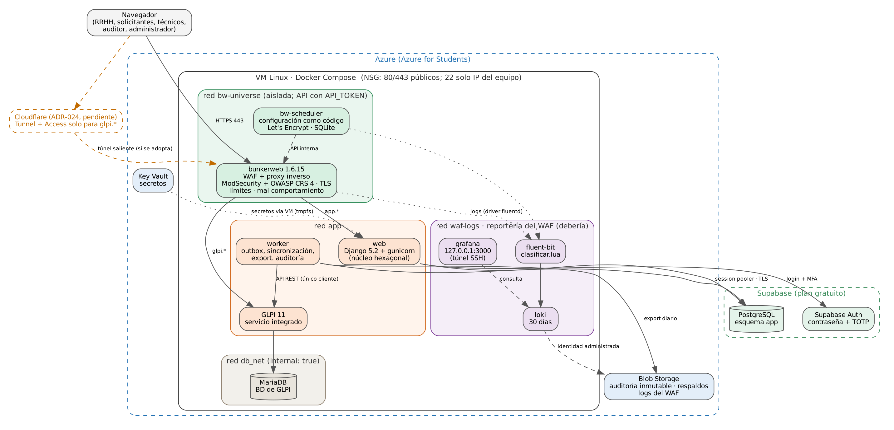
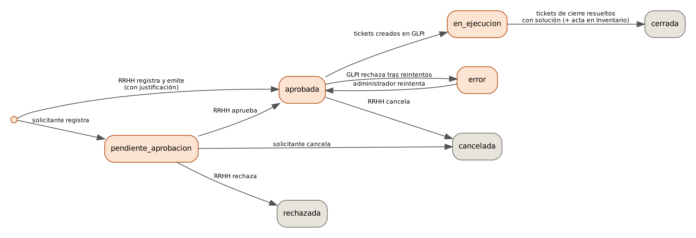
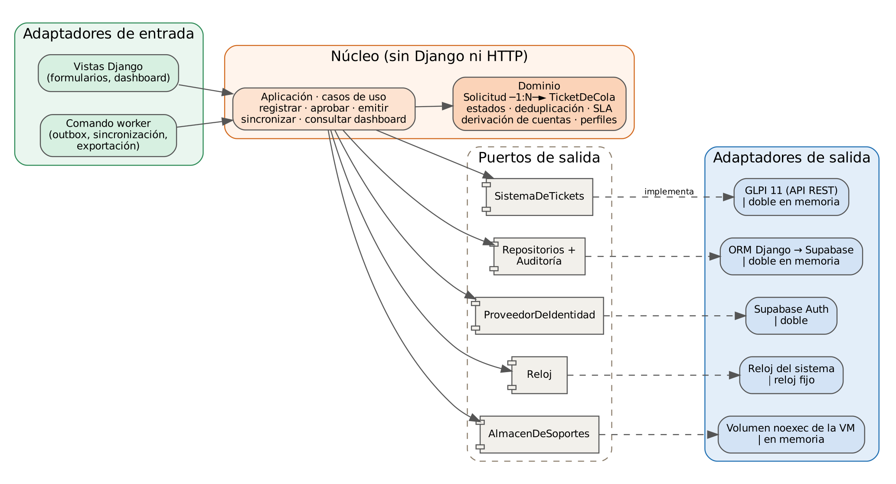

# Control del documento

| Campo | Valor |
|---|---|
| Proyecto | Sistema integrado de eventos laborales con identidad, recursos humanos y accesos automatizados |
| Documento | Especificación de Requisitos de Software (SRS) |
| Norma de referencia | ISO/IEC/IEEE 29148:2018, adaptada al alcance académico |
| Versión | 2.2 — Borrador para revisión |
| Fecha | 10 de octubre de 2026 |
| Autores | Jhinnet Bravo, Carlos Ruiz, Luis Ceron, Jhon Leal y Cristian Caro |
| Docente | José Eduardo Patiño Santafé |
| Estado | Pendiente de aprobación por el equipo y el docente |

| Versión | Fecha | Cambio |
|---|---|---|
| 1.0 | 05/10/2026 | Versión inicial. Consolida la Entrega 1, la Propuesta 2, los diagramas del equipo y las decisiones de la sesión de levantamiento de requisitos. |
| 2.0 | 07/10/2026 | Ajustes tras la revisión del equipo: base de datos en Supabase; sin automatizaciones fuera de GLPI; sin montaje de Samba AD; inicio de sesión con Supabase Auth; dashboard sin tiempo real para técnicos, con búsqueda de cuentas; arquitectura hexagonal con la solicitud y sus tickets como núcleo; Django como framework. Detalle en la sección 3.8. |
| 2.1 | 07/10/2026 | Soporte de vinculación obligatorio en el ingreso, adjunto a los tickets de GLPI; permisos sobre recursos compartidos con ruta y perfil (Consulta, Edición, Retiro de accesos) dentro de los eventos laborales. Basado en formularios de referencia de sistemas similares. |
| 2.2 | 10/10/2026 | El proxy inverso pasa a ser BunkerWeb (nginx + ModSecurity + OWASP CRS), tomando como referencia el proyecto `waf-stack` del equipo; se descarta Application Gateway por costo. Reportería de logs del WAF con Fluent Bit, Loki y Grafana. Cloudflare Tunnel + Access queda como propuesta pendiente (ADR-024). El SRS deja de generarse en Word. |

**Regla de mantenimiento.** La única fuente de este documento es `docs/SRS.md` en el repositorio. Desde la versión 2.2 no se genera en Word.

# Introducción

## Propósito

Este documento especifica los requisitos funcionales, no funcionales, de datos, de interfaces y de seguridad del sistema. Sirve como contrato entre el equipo del proyecto y el docente, como base para el diseño y la construcción, y como referencia para las pruebas de aceptación. Las instrucciones para el asistente de desarrollo (Claude Code) y el plan de trabajo se derivan de este documento.

## Alcance del producto

El sistema formaliza la interacción entre Recursos Humanos (RRHH) y Tecnología (TI) durante el ciclo de vida laboral de los colaboradores de una pyme ficticia, **Andina Servicios S.A.S.**, siguiendo el modelo Joiner–Mover–Leaver (JML).

El **núcleo** es una aplicación web propia. RRHH registra o aprueba cada evento laboral, y la aplicación lo convierte en tickets para las cuatro colas de TI: AD, Comunicaciones, Licencias e Inventario. La aplicación es dueña de ese ciclo (Solicitud → Tickets por cola).

**GLPI 11** es un servicio integrado, no el núcleo. Es donde TI trabaja cada ticket y es la fuente de la verdad sobre su estado. Puede seguir funcionando con sus propios procesos para tickets que no vienen de la aplicación.

**Todas las acciones técnicas las ejecutan personas.** La aplicación no escribe en ningún directorio ni servicio de identidad. Las únicas automatizaciones son las de GLPI y la integración aplicación↔GLPI:

- Creación de tickets por API.
- Reglas de enrutamiento, SLA y escalamiento de GLPI.
- Tickets con fecha programada.

**Incluye:**

1. Aplicación web para registrar, aprobar, consultar y cancelar solicitudes de eventos laborales.
2. Prevención de solicitudes duplicadas, garantizada por la base de datos.
3. Creación de tickets en GLPI por cola. Cada ticket lleva la lista de verificación de su perfil de acceso, incluidos los recursos compartidos con su ruta y perfil (Consulta, Edición o Retiro de accesos), y una plantilla de solución obligatoria. En los ingresos, el soporte de vinculación (acta de inicio o acto de nombramiento) se adjunta a los tickets de identidad. Los tickets de fechas futuras (reactivación tras vacaciones, eliminación de cuentas) se crean ya programados.
4. Configuración de GLPI como servicio integrado: categorías, grupos, reglas de negocio de enrutamiento, SLA, escalamiento de emergencias y plantillas de solución.
5. Sincronización periódica del estado de los tickets y de los activos y licencias asignados en GLPI.
6. Registro del estado de las cuentas de cada colaborador, derivado de los tickets resueltos.
7. Dashboard para técnicos, sin tiempo real, con indicadores de tickets pendientes, cuentas y equipos, más una búsqueda de cuentas con la ficha completa del colaborador.
8. Registro de auditoría inalterable.
9. Inicio de sesión con Supabase Auth y MFA obligatorio.
10. Firewall de aplicaciones web (WAF) BunkerWeb delante de la aplicación y de GLPI, con OWASP CRS, límite de peticiones y bloqueo por mal comportamiento, más la reportería de sus logs.

**Excluye:**

1. Cualquier ejecución automática sobre directorios o servicios de identidad (AD, Entra ID, Microsoft 365, equipos de red). El técnico las hace a mano y las documenta en la solución del ticket.
2. Montaje de Samba AD o de cualquier controlador de dominio en el entregable. AD, el servidor de archivos y la red existen solo como parte del escenario de la empresa ficticia.
3. Buzones de correo y licencias reales de Microsoft 365.
4. Notificaciones por correo de GLPI y tareas programadas de la aplicación que creen tickets nuevos con el paso del tiempo.
5. Visualizaciones o actualizaciones en tiempo real (websockets, Supabase Realtime, recarga automática).
6. Monitoreo del controlador de dominio, rutinas de limpieza e integración con un SIEM.
7. Nómina u otros procesos de RRHH distintos del evento laboral.
8. Datos personales reales. Todos los datos de prueba son ficticios.

## Definiciones, acrónimos y abreviaturas

| Término | Definición |
|---|---|
| Adaptador | Componente que conecta el núcleo con una tecnología concreta (Django, GLPI, Supabase). Implementa un puerto. |
| Arquitectura hexagonal | Estilo de arquitectura (puertos y adaptadores) en el que el dominio y los casos de uso no dependen de frameworks ni de sistemas externos. |
| Cola | Grupo técnico de GLPI que atiende un tipo de trabajo: AD, Comunicaciones, Licencias o Inventario. |
| Cuenta (registro) | Estado de un acceso del colaborador en un sistema (AD, Red o M365) según los tickets resueltos. No es una lectura del sistema real. |
| Emisión | Momento en que una solicitud aprobada genera sus tickets. |
| Evento laboral | Ingreso, vacaciones, cambio de departamento, cambio de sucursal, retiro o emergencia. |
| Exposición | Tiempo transcurrido desde la fecha efectiva de un retiro o emergencia mientras algún ticket de baja siga sin resolver. |
| GLPI | Herramienta libre de mesa de servicio e inventario, integrada como servicio externo. |
| JML | Joiner–Mover–Leaver: modelo de ingreso, cambio y retiro. |
| MFA / TOTP | Autenticación multifactor con códigos temporales de una aplicación autenticadora. |
| Perfil de acceso | Conjunto de grupos, licencias y tipo de equipo que corresponde a un departamento y una sede. |
| Perfil de recurso | Nivel de permiso sobre un recurso compartido: **Consulta** (lectura), **Edición** (lectura y escritura) o **Retiro de accesos** (quitar todo permiso). |
| Plantilla de solución | Texto estructurado por cola que el técnico completa obligatoriamente al resolver un ticket en GLPI. |
| Puerto | Interfaz definida por el núcleo para hablar con el exterior, por ejemplo `SistemaDeTickets`. |
| Soporte de vinculación | Documento PDF que respalda un ingreso: acta de inicio firmada (contratistas) o acto administrativo de nombramiento o contrato (demás vinculaciones). |
| Solicitud | Registro de un evento laboral para un colaborador. Es el agregado central del dominio. |
| STRIDE | Clasificación de amenazas: suplantación, manipulación, repudio, divulgación de información, denegación de servicio y elevación de privilegios. |
| Supabase | Plataforma gestionada que provee PostgreSQL y un servicio de autenticación (Supabase Auth). |
| Ticket de cierre | Ticket que debe resolverse para cerrar la solicitud. |
| Ticket posterior | Ticket programado para después del cierre (eliminación de cuentas a los 90 días). No bloquea el cierre de la solicitud. |
| Ticket programado | Ticket creado al emitir la solicitud, en estado «En espera» de GLPI, con vencimiento en una fecha futura. |

## Referencias

Ver la sección «Referencias» al final del documento.

## Organización del documento

La sección 3 describe el sistema en su contexto y la sección 4 modela el proceso. Las secciones 5 a 8 contienen los requisitos, identificados como RF (funcionales), RD (datos), RI (interfaces), RS (seguridad) y RNF (otros no funcionales). La sección 9 presenta el análisis STRIDE, la 10 la arquitectura y la 11 las herramientas. Las secciones 12 a 15 cubren la verificación, la trazabilidad, los riesgos y la matriz RACI.

Los requisitos usan dos niveles de obligación: **debe** (obligatorio para la aceptación) y **debería** (deseable; se recorta primero si falta tiempo).

# Descripción general

## Perspectiva del producto

El sistema reemplaza los correos y solicitudes informales entre RRHH y TI por un flujo único:

1. **Solicitud.** La registra un colaborador autenticado o directamente RRHH.
2. **Aprobación y emisión.** RRHH aprueba y la aplicación genera los tickets.
3. **Ejecución en GLPI.** Los técnicos resuelven los tickets con una solución estructurada.
4. **Cierre y registro.** La aplicación sincroniza el resultado, cierra la solicitud y actualiza el estado de las cuentas.

{width=6in}

## Funciones del producto

| Función | Descripción resumida |
|---|---|
| F1. Autenticación y roles | Inicio de sesión con Supabase Auth y TOTP obligatorio; permisos por rol. |
| F2. Gestión de solicitudes | Registro con fecha efectiva, consulta, cancelación y deduplicación. |
| F3. Aprobación | RRHH aprueba o rechaza con justificación; la solicitud aprobada queda inmutable. |
| F4. Emisión de tickets | Un ticket por cola involucrada, con lista de verificación, prioridad, SLA y, cuando aplica, fecha programada. |
| F5. Sincronización | Estado de los tickets, soluciones, actas y activos desde GLPI, cada 5 minutos. |
| F6. Registro de cuentas | Estado de las cuentas por sistema, derivado de los tickets resueltos. |
| F7. Dashboard | Indicadores para técnicos con los datos de la última sincronización, más búsqueda de cuentas y ficha del colaborador. |
| F8. Auditoría | Registro inalterable de cada decisión, emisión, cambio de estado y acceso a datos personales. |
| F9. Administración | Matriz de perfiles, catálogos y asignación de roles. |

## Clases de usuarios y roles

Los roles se gestionan como grupos de Django, que asigna el Administrador del sistema. Una persona puede tener más de un rol, salvo las incompatibilidades indicadas.

| Rol | Quién | Permisos en la aplicación | Incompatible con |
|---|---|---|---|
| Solicitante | Cualquier colaborador activo con usuario | Registrar sus propias vacaciones y su renuncia. Si es jefe, registrar cambios de departamento o sucursal de sus subordinados directos. Consultar y cancelar sus solicitudes pendientes. | — |
| RRHH | Una persona de Recursos Humanos (cuenta única) | Registrar y emitir cualquier tipo de evento. Aprobar o rechazar solicitudes. Ver campos restringidos. Consultar el estado de todas las solicitudes y los contratos próximos a vencer. Cancelar solicitudes aprobadas sin tickets creados. | Roles técnicos y Administrador |
| Técnico AD | Cola AD | Dashboard, búsqueda de cuentas y fichas. Trabaja sus tickets en GLPI. | RRHH |
| Técnico Comunicaciones | Cola Comunicaciones | Igual que Técnico AD. | RRHH |
| Técnico Licencias | Cola Licencias (M365) | Igual que Técnico AD. | RRHH |
| Técnico Inventario | Cola Inventario | Igual que Técnico AD. | RRHH |
| Auditor | Docente o revisor | Leer la auditoría y verificar su integridad. Leer solicitudes sin campos restringidos. | Todos los demás |
| Administrador del sistema | Responsable técnico del proyecto | Mantener la matriz de perfiles, los catálogos y los roles. Reintentar la emisión de solicitudes en `error`. No aprueba solicitudes. | RRHH y técnicos |

**Control de doble firma.** RRHH es una sola cuenta (ADR-005). Ningún cambio de acceso ocurre con una sola firma:

- Solicitudes registradas por un colaborador: firman el solicitante y RRHH.
- Solicitudes emitidas directamente por RRHH: firman RRHH, que justifica la emisión, y el técnico que ejecuta y documenta la acción en GLPI.

## Entorno operativo

| Elemento | Especificación |
|---|---|
| Nube | Microsoft Azure, suscripción Azure for Students (crédito de USD 100 por 12 meses, sin tarjeta de crédito). Región East US, a confirmar entre las permitidas en el sprint 0. |
| Cómputo | Una VM Linux (Ubuntu Server 24.04 LTS), tamaño B2s (2 vCPU, 4 GiB), con apagado automático nocturno. |
| Orquestación | Docker Engine y Docker Compose v2. |
| Base de datos de la aplicación | Proyecto de Supabase en el plan gratuito, región `us-east-1`, cercana a la VM. Un proyecto para desarrollo y otro para la entrega (el plan permite 2 activos). |
| Autenticación | Supabase Auth del mismo proyecto: correo y contraseña con TOTP. Registro abierto deshabilitado. |
| Base de datos de GLPI | MariaDB en contenedor. GLPI 11 solo admite MySQL 8.0+ o MariaDB 10.6+. |
| Navegadores | Últimas dos versiones de Chrome, Edge y Firefox. |
| Desarrollo local | El mismo `docker compose`. Las pruebas usan PostgreSQL en contenedor con la misma versión mayor que el proyecto de Supabase. |

## Restricciones de diseño e implementación

1. Toda la solución debe correr con servicios gratuitos o cubiertos por el crédito de Azure for Students.
2. La aplicación propia es el núcleo; GLPI 11 es un servicio integrado. No se desarrollan en la aplicación funciones de tickets o inventario que GLPI ya ofrece.
3. La aplicación no ejecuta acciones sobre directorios ni servicios de identidad. Solo se automatiza dentro de GLPI o en la integración aplicación↔GLPI (ADR-019).
4. La base de datos de la aplicación es Supabase (PostgreSQL). GLPI conserva su propia MariaDB.
5. Arquitectura hexagonal: el dominio y los casos de uso no importan Django, el ORM ni clientes HTTP (ADR-016).
6. Backend en Python con Django 5.2 LTS. Interfaz generada en el servidor, sin SPA ni JavaScript de terceros (ADR-018).
7. Todo ticket de evento laboral se origina en RRHH: lo emite RRHH directamente o se emite cuando RRHH aprueba.
8. Los secretos nunca se guardan en el código, en GLPI ni en la base de datos.
9. Los datos de prueba son ficticios, pero el diseño cumple los principios de la Ley 1581 de 2012.

## Supuestos y dependencias

| ID | Supuesto o dependencia | Si no se cumple |
|---|---|---|
| SUP-01 | Un integrante activa Azure for Students. | Despliegue solo local con Docker Compose para la sustentación. Se pierde la URL pública y la copia en Blob pasa a Supabase Storage. |
| SUP-02 | La actividad periódica del worker contra la base de datos impide que Supabase pause el proyecto (pausa tras 1 semana de inactividad en el plan gratuito). | Se valida en el sprint 0. Alternativa: reactivar el proyecto antes de cada demo y documentarlo en el manual de operación. |
| SUP-03 | La API de GLPI 11 permite autenticarse como servicio para crear tickets, seguimientos y usuarios; subir documentos y vincularlos a tickets; y leer tickets, soluciones, documentos, activos y licencias. | Se valida en el sprint 0. Alternativa: API v1 con token de aplicación y token de usuario de servicio. |
| SUP-04 | GLPI permite exigir una solución con plantilla por categoría al resolver un ticket. | Se valida en el sprint 0. Si no se puede forzar en GLPI, la aplicación no cuenta como resuelto un ticket sin solución (RF-24). |
| SUP-05 | El flujo de Supabase Auth con MFA (contraseña, inscripción, desafío y verificación del TOTP) se puede ejecutar desde el servidor con la biblioteca oficial de Python. | Se valida en el sprint 0. Alternativa: llamar directamente a la API REST de Supabase Auth. |
| SUP-06 | La empresa ficticia tiene entre 50 y 300 colaboradores, 3 sedes y unos 50 eventos al mes. | Los requisitos de rendimiento se recalculan. |

## Correcciones respecto de la Propuesta 2

| # | Origen | Problema | Corrección |
|---|---|---|---|
| C1 | Deduplicación | Contaba «aprobado» y «en progreso» como estados finales, lo que permitía duplicados durante la ejecución. | Estados abiertos: `pendiente_aprobacion`, `aprobada`, `en_ejecucion` y `error` (RF-09). |
| C2 | Deduplicación | Mencionaba una «ventana de enfriamiento» sin definirla. | Se elimina. |
| C3 | Criterios de aceptación | Exigía autorización de «líderes de operación», lo que contradice que RRHH aprueba. | RRHH aprueba; los jefes participan como solicitantes. |
| C4 | Flujo | Al cerrar el ticket se llamaba a Graph API. | Se elimina: no hay automatizaciones fuera de GLPI (ADR-019). |
| C5 | Alcance | El monitoreo del DC y las rutinas de limpieza no son parte de la gestión de identidades. | Se excluyen. El criterio de disponibilidad se cumple con chequeos de salud y respaldo con restauración probada. |
| C6 | Riesgos | Citaba un «plan de contingencia» inexistente. | Se define en la sección 14. |
| C7 | Flujo | La categorización por palabras clave es frágil. | La aplicación fija la categoría y una regla de negocio de GLPI asigna el grupo (RF-19). |
| C8 | Diagrama de contenedores | No incluía GLPI. | Se agrega como servicio integrado. |

## Cambios de la versión 2.0

| # | Cambio | Requisitos y decisiones afectados |
|---|---|---|
| V1 | La base de datos de la aplicación pasa de PostgreSQL en contenedor a Supabase (plan gratuito), sin usar su Data API. | RD-10, RS-15, RS-16, ADR-015 |
| V2 | Se eliminan las acciones automatizadas sobre AD y Entra ID, la consola técnica de autorización, la ejecución programada y las contraseñas iniciales. Toda acción técnica es manual y se documenta en GLPI. | ADR-003, ADR-004 y ADR-010 reemplazados por ADR-019 |
| V3 | No se monta Samba AD. AD, red y M365 son parte del escenario; los tickets llevan la lista de verificación del perfil. | ADR-003 reemplazado |
| V4 | Inicio de sesión con Supabase Auth y TOTP obligatorio, mediado por el servidor. | RF-01 a RF-06, ADR-008 reemplazado por ADR-017 |
| V5 | Dashboard obligatorio para técnicos, sin tiempo real, con búsqueda de cuentas y ficha del colaborador. | RF-29 a RF-33, ADR-020 |
| V6 | Arquitectura hexagonal con la solicitud y sus tickets como núcleo; GLPI es un adaptador. | ADR-016 |
| V7 | Django 5.2 LTS con interfaz generada en el servidor, en lugar de FastAPI con React. | ADR-012 reemplazado por ADR-018 |
| V8 | Las fechas futuras se manejan con tickets programados creados en la emisión, no con un planificador de la aplicación. | RF-17 |
| V9 | El estado de las cuentas se deriva de los tickets resueltos. | RF-26 a RF-28 |
| V10 | (v2.1) Soporte de vinculación PDF obligatorio en el ingreso, validado por la aplicación y adjuntado a los tickets de AD y Licencias en GLPI. La aplicación no lo almacena de forma permanente. | RF-39, RF-40, RD-12, RS-17, ADR-021 |
| V11 | (v2.1) Los permisos sobre recursos compartidos se especifican con ruta, serie documental y perfil dentro de la matriz de perfiles, y viajan en los tickets de los eventos. No hay un tipo de solicitud de acceso independiente. | §4.9, RF-16, ADR-022 |
| V12 | (v2.2) BunkerWeb reemplaza a nginx como proxy inverso y WAF; se descarta Application Gateway por costo. Reportería del WAF con Fluent Bit, Loki y Grafana (debería). Cloudflare Tunnel + Access como propuesta pendiente. | RS-01, RS-02, RS-07, RS-08, RS-17 a RS-20, RNF-16, ADR-023, ADR-024 |

# Modelo del proceso

## Tipos de evento y quién los registra

| Código | Evento | JML | Quién puede registrarlo | Aprobación | Prioridad en GLPI | SLA de atención en GLPI |
|---|---|---|---|---|---|---|
| ING | Ingreso | Joiner | RRHH | Emitida por RRHH | Media | Resuelto antes de la fecha de ingreso |
| VAC | Vacaciones | Mover (temporal) | El colaborador o RRHH | RRHH | Media | Suspensión resuelta el día de inicio; reactivación el día de regreso |
| CDP | Cambio de departamento o cargo | Mover | El jefe del colaborador o RRHH | RRHH | Media | 1 día hábil desde la fecha efectiva |
| CSU | Cambio de sucursal | Mover | El jefe del colaborador o RRHH | RRHH | Media | 1 día hábil desde la fecha efectiva |
| RET | Retiro (subtipos: renuncia, fin de contrato) | Leaver | El colaborador (renuncia) o RRHH | RRHH | Alta | Resuelto al final del último día laborado |
| EMG | Emergencia (subtipos: despido con justa causa, fuga detectada) | Leaver inmediato | Solo RRHH | Emitida por RRHH | Muy alta | 1 hora desde la emisión, con escalamiento en GLPI |

**Reglas generales:**

- Un colaborador no puede registrar eventos sobre sí mismo, salvo vacaciones y renuncia.
- RRHH no puede aprobar ni emitir solicitudes cuyo sujeto sea la propia persona de RRHH. Estas las emite el Administrador del sistema como excepción registrada en auditoría.
- Una fuga detectada la reporta Seguridad o TI a RRHH por fuera del sistema, y RRHH emite la emergencia indicando quién la reportó.
- Contratistas, practicantes y temporales siguen el mismo flujo, con fecha de fin obligatoria. RRHH ve en su bandeja los contratos que vencen en los próximos 7 días para emitir el retiro por fin de contrato (RF-28).

## Estados de la solicitud

{width=6in}

| Estado | Tipo | Significado |
|---|---|---|
| `pendiente_aprobacion` | Abierto | Registrada por un solicitante; espera la decisión de RRHH. |
| `aprobada` | Abierto | Aprobada o emitida; los tickets están en la bandeja de salida hacia GLPI. |
| `en_ejecucion` | Abierto | Tickets creados en GLPI; las colas están trabajando. |
| `error` | Abierto | GLPI rechazó la creación de un ticket tras los reintentos. El Administrador revisa y reintenta. |
| `cerrada` | Final | Todos los tickets de cierre están resueltos con solución (y con acta en Inventario). |
| `rechazada` | Final | RRHH la rechazó, con justificación. |
| `cancelada` | Final | La canceló el solicitante (antes de la aprobación) o RRHH (antes de que se creara algún ticket). |

Si un ticket se reabre en GLPI después del cierre, la solicitud sigue `cerrada`. El ticket y la cuenta derivada sí reflejan la reapertura, y el dashboard la muestra (RF-25).

## Tickets: de cierre, programados y posteriores

| Clase | Cuándo se crea | Estado inicial en GLPI | ¿Bloquea el cierre de la solicitud? |
|---|---|---|---|
| De cierre inmediato | En la emisión | Nuevo | Sí |
| De cierre programado | En la emisión, con vencimiento en la fecha futura (p. ej., la reactivación tras vacaciones) | En espera, hasta la fecha | Sí |
| Posterior | En la emisión de RET o EMG, con vencimiento a 90 días (eliminación de cuentas) | En espera, hasta la fecha | No |

El dashboard separa los tickets programados de los pendientes. Un ticket programado cuenta como pendiente solo cuando llega su fecha.

## Matriz evento × cola

Cada celda resume la lista de verificación que lleva el ticket de esa cola. Todas las acciones son manuales. Las marcadas con (P) son tickets programados.

| Evento | AD | Comunicaciones | Licencias (M365) | Inventario |
|---|---|---|---|---|
| ING | Verificar el soporte de vinculación adjunto; crear la cuenta con el usuario sugerido; agregar los grupos del perfil; aplicar en cada recurso compartido del perfil su perfil (Consulta o Edición) mediante el grupo `FS-*`; para contratistas, fijar la fecha de expiración. | Agregar los grupos de red del perfil (`NET-*`). | Verificar el soporte de vinculación adjunto; crear la identidad en M365 o Entra ID; registrar las licencias del perfil en GLPI. | Asignar el equipo al usuario en GLPI y adjuntar el acta de entrega firmada. |
| VAC | Deshabilitar la cuenta al inicio. (P) Habilitarla en la fecha de regreso. | — | Bloquear el inicio de sesión y revocar sesiones al inicio. (P) Desbloquear al regreso. | — |
| CDP | Quitar los grupos del perfil anterior y agregar los del nuevo. En recursos compartidos: aplicar el perfil de los recursos nuevos y «Retiro de accesos» en los que ya no corresponden (la diferencia la calcula la aplicación). | Diferencia de grupos `NET-*`, si cambia. | Diferencia de grupos y de licencias. | Cambiar el equipo, solo si el nuevo perfil lo exige. |
| CSU | Diferencia de los grupos de sede. | Quitar `NET-VLAN-<sede anterior>` y agregar `NET-VLAN-<sede nueva>`. | — | Trasladar el equipo, con acta. |
| RET | Deshabilitar la cuenta, cambiar la contraseña, quitar los grupos, «Retiro de accesos» en todos los recursos compartidos, mover a la OU `Deshabilitados` y dar al jefe perfil Consulta sobre la carpeta personal por 30 días. (Posterior) Eliminar la cuenta a los 90 días. | Quitar todos los grupos `NET-*`. | Bloquear el inicio de sesión, revocar sesiones, quitar grupos y liberar licencias en GLPI. (Posterior) Eliminar la identidad a los 90 días. | Recibir el equipo con acta y paz y salvo. |
| EMG | Las mismas acciones de RET, de inmediato. (Posterior) Eliminar a los 90 días. | Las mismas de RET, de inmediato. | Las mismas de RET, de inmediato. (Posterior) Eliminar a los 90 días. | Recuperar el equipo con acta. |

## Suspensión frente a deshabilitación

Estas reglas forman parte de las instrucciones de los tickets para los técnicos.

| Aspecto | Suspensión (VAC) | Deshabilitación (RET, EMG) |
|---|---|---|
| Cuenta | Deshabilitada | Deshabilitada y movida a la OU `Deshabilitados` |
| Contraseña | Sin cambios | Cambiada a un valor aleatorio que no se comunica a nadie |
| Grupos | Se conservan | Se quitan; el técnico lista en la solución los grupos retirados |
| Sesiones | Revocadas | Revocadas |
| Reversión | Ticket programado de reactivación | No se revierte. Un reingreso es un evento ING nuevo |
| Eliminación | No aplica | Ticket posterior a los 90 días |

## Plantillas de solución por cola

Al resolver un ticket en GLPI, el técnico debe completar la plantilla de su cola. **Ninguna plantilla incluye contraseñas**: la contraseña inicial se entrega al colaborador por un canal fuera del sistema y nunca se escribe en GLPI ni en la aplicación.

| Cola | Campos de la plantilla |
|---|---|
| AD | Acción realizada; usuario (`sAMAccountName`); soporte de vinculación verificado (sí/no, solo en ingresos); grupos agregados; grupos retirados; recursos compartidos (ruta – perfil aplicado o retirado); OU final; fecha y hora de ejecución; observaciones. |
| Comunicaciones | Acción realizada; grupos de red agregados; grupos de red retirados; fecha y hora; observaciones. |
| Licencias | Acción realizada; identidad (UPN); soporte de vinculación verificado (sí/no, solo en ingresos); grupos agregados o retirados; licencias asignadas o liberadas en GLPI; sesiones revocadas (sí/no); fecha y hora. |
| Inventario | Acción realizada; número de serie; modelo; entregado o recibido; acta adjunta (sí/no); paz y salvo (sí/no). |

## Derivación del estado de las cuentas

La aplicación lleva un registro por colaborador y por sistema: AD (cola AD), Red (Comunicaciones) y M365 (Licencias). El estado cambia solo por la sincronización de tickets, nunca por edición manual (RD-11). El dashboard lo rotula como «estado según tickets resueltos».

| Ticket del sistema correspondiente | Mientras está abierto | Al resolverse con solución |
|---|---|---|
| ING | `pendiente_alta` | `activa` |
| VAC, suspensión | `pendiente_suspension` | `suspendida` |
| VAC, reactivación (programado) | `suspendida` | `activa` |
| CDP o CSU | Conserva el estado actual y se marca «cambio pendiente» | `activa`, con el perfil nuevo |
| RET o EMG | `pendiente_baja` (cuenta como exposición) | `deshabilitada` |
| Eliminación (posterior) | `deshabilitada` | `eliminada` |

Reglas complementarias:

- Un ticket marcado como resuelto pero **sin solución** no cambia el estado de la cuenta y se muestra como «cierre sin solución».
- Un ticket **reabierto** devuelve la cuenta al estado que tenía antes de ese ticket y se marca como «reabierto».
- Los **equipos** se toman de la asignación real de activos en GLPI, no de los tickets.

## Catálogo de campos por tipo de evento

Todos los tipos comparten estos campos: colaborador, tipo, subtipo, fecha efectiva, solicitante, justificación, estado y referencias a los tickets. Los campos marcados con «R» son restringidos: solo los ve RRHH y nunca se envían a GLPI.

| Tipo | Campos específicos |
|---|---|
| ING | Nombres; apellidos; número de documento (ficticio); tipo de vinculación (empleado, contratista, practicante o temporal); departamento; cargo; sede; jefe directo; fecha de ingreso; fecha de fin (obligatoria si no es empleado); requiere equipo (sí o no) y tipo de equipo; **soporte de vinculación** (PDF obligatorio, máximo 20 MB): acta de inicio firmada si es contratista, acto administrativo de nombramiento o contrato en los demás casos. |
| VAC | Fecha de inicio; fecha de regreso. |
| CDP | Departamento nuevo; cargo nuevo; jefe nuevo; fecha efectiva. |
| CSU | Sede nueva; fecha efectiva; ¿se traslada el equipo? (sí o no). |
| RET | Subtipo; último día laborado; motivo (R). |
| EMG | Subtipo; reportado por; descripción del hecho (R); hora del hecho. |

La justificación de RRHH es obligatoria al rechazar y al emitir directamente, y opcional al aprobar una solicitud de un solicitante.

## Matriz de perfiles de acceso inicial

La matriz alimenta las listas de verificación de los tickets y la diferencia de grupos en los eventos de cambio. El Administrador del sistema la mantiene y cada cambio queda auditado. Estos son los valores iniciales (datos ficticios):

| Departamento | Grupos de AD | Grupos de red | Grupos de M365 | Licencias de software (GLPI) | Equipo |
|---|---|---|---|---|---|
| Gerencia | `GG-Gerencia`, `FS-Gerencia-RW`, `FS-Comun-RO` | `NET-VPN`, `NET-WIFI-CORP` | `M365-Gerencia` | Suite ofimática, lector PDF | Portátil |
| RRHH | `GG-RRHH`, `FS-RRHH-RW`, `FS-Comun-RO` | `NET-WIFI-CORP` | `M365-RRHH` | Suite ofimática | Portátil |
| Finanzas | `GG-Finanzas`, `FS-Finanzas-RW`, `FS-Presupuesto-RO`, `FS-Comun-RO` | `NET-WIFI-CORP` | `M365-Finanzas` | Suite ofimática, software contable | Escritorio |
| Comercial | `GG-Comercial`, `FS-Comercial-RW`, `FS-Comun-RO` | `NET-VPN`, `NET-WIFI-CORP` | `M365-Comercial` | Suite ofimática, CRM | Portátil |
| TI | `GG-TI`, `FS-TI-RW`, `FS-Comun-RW` | `NET-VPN`, `NET-WIFI-CORP`, `NET-ADMIN` | `M365-TI` | Suite ofimática, herramientas de soporte | Portátil |
| Operaciones | `GG-Operaciones`, `FS-Operaciones-RW`, `FS-Comun-RO` | `NET-WIFI-CORP` | `M365-Operaciones` | Suite ofimática | Escritorio |

Además, por sede se asigna `GG-Sede-<Bogota|Medellin|Cali>` y `NET-VLAN-<sede>`.

**Recursos compartidos por departamento.** Cada recurso tiene ruta completa, recurso raíz o serie documental, perfil y el grupo que lo materializa. El perfil **Retiro de accesos** no se configura en la matriz: lo genera la aplicación al retirar un recurso (CDP) o todos (RET, EMG).

| Departamento | Ruta completa del recurso | Recurso raíz o serie documental | Perfil | Grupo |
|---|---|---|---|---|
| Todos, salvo TI | `\\fs01.ad.andina.test\comun` | Común | Consulta | `FS-Comun-RO` |
| TI | `\\fs01.ad.andina.test\comun` | Común | Edición | `FS-Comun-RW` |
| Gerencia | `\\fs01.ad.andina.test\departamentos\Gerencia` | Gerencia | Edición | `FS-Gerencia-RW` |
| RRHH | `\\fs01.ad.andina.test\departamentos\RRHH\Hojas de vida` | Historias laborales | Edición | `FS-RRHH-RW` |
| Finanzas | `\\fs01.ad.andina.test\departamentos\Finanzas\Contabilidad` | Contabilidad | Edición | `FS-Finanzas-RW` |
| Finanzas | `\\fs01.ad.andina.test\departamentos\Gerencia\Presupuesto` | Presupuesto | Consulta | `FS-Presupuesto-RO` |
| Comercial | `\\fs01.ad.andina.test\departamentos\Comercial` | Comercial | Edición | `FS-Comercial-RW` |
| TI | `\\fs01.ad.andina.test\departamentos\TI` | TI | Edición | `FS-TI-RW` |
| Operaciones | `\\fs01.ad.andina.test\departamentos\Operaciones` | Operaciones | Edición | `FS-Operaciones-RW` |

El ticket de la cola AD lista cada recurso con su ruta, serie, perfil y grupo, para que el técnico lo aplique y lo documente en la solución.

## Convención de nombres de cuenta

La aplicación sugiere el usuario en el ticket de ingreso y garantiza que sea único entre sus colaboradores. El técnico lo confirma en la solución.

| Atributo | Regla | Ejemplo |
|---|---|---|
| Usuario | `nombre.apellido`, en minúsculas, sin tildes ni ñ (ñ → n), truncado a 20 caracteres. Si ya existe, se usa el segundo apellido y después un sufijo numérico. | `maria.gomez`, `maria.gomez.r`, `maria.gomez2` |
| UPN de AD | `<usuario>@ad.andina.test` (dominio ficticio reservado `.test`) | `maria.gomez@ad.andina.test` |
| UPN de M365 | `<usuario>@andina.example` (dominio ficticio reservado `.example`) | `maria.gomez@andina.example` |

# Requisitos funcionales

## Autenticación y autorización

| ID | Requisito | Prioridad |
|---|---|---|
| RF-01 | El sistema debe autenticar con Supabase Auth (correo y contraseña) **desde el servidor**. Solo debe crear la sesión de Django después de verificar un código TOTP (nivel AAL2). Los tokens de Supabase no se guardan en el navegador ni en la sesión. | Debe |
| RF-02 | En el primer ingreso, el sistema debe exigir la inscripción de un factor TOTP antes de permitir cualquier otra acción. | Debe |
| RF-03 | El sistema debe aplicar los permisos de la sección 3.3 en cada vista del servidor, según los grupos de Django del usuario. | Debe |
| RF-04 | El sistema debe cerrar la sesión tras 30 minutos de inactividad o 8 horas de duración total, y rotar el identificador de sesión al iniciarla. | Debe |
| RF-05 | El sistema debe negar el acceso y registrar el evento en auditoría si un usuario tiene roles incompatibles. | Debe |
| RF-06 | El registro abierto debe estar deshabilitado. Las cuentas de usuario solo se crean y desactivan con un comando de administración que ejecuta el Administrador del sistema. | Debe |

## Gestión de solicitudes

| ID | Requisito | Prioridad |
|---|---|---|
| RF-07 | El sistema debe permitir registrar solicitudes de los tipos de la sección 4.1, con los campos del catálogo (sección 4.8) y validación en el servidor. | Debe |
| RF-08 | El sistema debe aceptar una fecha efectiva futura. | Debe |
| RF-09 | El sistema debe rechazar una solicitud nueva cuando exista otra abierta para el mismo colaborador y el mismo tipo. La respuesta debe incluir el identificador de la solicitud existente. La regla la garantiza la base de datos (RD-01). | Debe |
| RF-10 | Las solicitudes EMG deben aceptarse aunque existan otras abiertas de otros tipos para el mismo colaborador. Al emitirse, esas otras se marcan para que RRHH las revise. | Debe |
| RF-11 | El solicitante debe poder cancelar su solicitud mientras esté pendiente de aprobación. RRHH debe poder cancelar una solicitud aprobada mientras no se haya creado ningún ticket. | Debe |
| RF-39 | El registro de un ingreso debe exigir el soporte de vinculación. El sistema lo acepta solo si es PDF (extensión y firma `%PDF-` del contenido) y pesa como máximo 20 MB. Lo guarda con un nombre aleatorio fuera de la base de datos y registra su nombre original saneado, tamaño y hash SHA-256. La aplicación nunca abre, procesa ni sirve el archivo. | Debe |

## Aprobación y emisión

| ID | Requisito | Prioridad |
|---|---|---|
| RF-12 | RRHH debe poder aprobar o rechazar solicitudes pendientes. Rechazar exige justificación. | Debe |
| RF-13 | RRHH debe poder registrar y emitir cualquier tipo de evento en un solo paso, con justificación obligatoria. | Debe |
| RF-14 | Una vez aprobada, el contenido de la solicitud no debe poder modificarse; la base de datos lo impone con un disparador. Para corregirla, RRHH la cancela y registra una nueva vinculada a la anterior. | Debe |
| RF-15 | El sistema debe impedir que RRHH apruebe o emita solicitudes cuyo sujeto sea la propia persona de RRHH. | Debe |

## Tickets e integración con GLPI

| ID | Requisito | Prioridad |
|---|---|---|
| RF-16 | Al emitirse una solicitud, el dominio debe generar un ticket por cola según la matriz evento × cola (sección 4.4). Cada ticket lleva la lista de verificación calculada desde la matriz de perfiles (incluidos los recursos compartidos con ruta, serie, perfil y grupo), la prioridad y el vencimiento según el SLA. | Debe |
| RF-17 | Los tickets con fecha futura (reactivación de vacaciones y eliminación a los 90 días) deben crearse en la emisión, en estado «En espera» y con vencimiento en esa fecha. La aplicación no crea tickets después de la emisión. | Debe |
| RF-18 | La creación de tickets en GLPI debe hacerse mediante una bandeja de salida (outbox) con reintentos e idempotencia, de modo que una caída de GLPI no pierda ni duplique tickets. Tras 10 intentos fallidos, la solicitud pasa a `error`. | Debe |
| RF-19 | Cada ticket se crea con su categoría ITIL. Una regla de negocio de GLPI asigna el grupo técnico según la categoría, y los tickets sin categoría reconocida van a «Revisión manual». | Debe |
| RF-20 | El contenido del ticket debe limitarse a los datos técnicos necesarios: colaborador, usuario sugerido, perfil, fecha efectiva, lista de verificación y referencia a la solicitud. Nunca debe incluir campos restringidos ni contraseñas. | Debe |
| RF-40 | Al crear los tickets de un ingreso, el worker debe subir el soporte de vinculación a GLPI una sola vez y vincularlo a los tickets de AD y de Licencias. Después de confirmar la subida y el hash, debe borrar la copia temporal. Si la solicitud se cancela, la copia se borra sin subirse. | Debe |
| RF-21 | El sistema debe crear o actualizar en GLPI el usuario del colaborador, sin credenciales de inicio de sesión, para poder asignarle activos y licencias. | Debe |
| RF-22 | El worker debe sincronizar cada 5 minutos el estado, la solución y los documentos adjuntos de los tickets creados por la aplicación. Los tickets que GLPI gestione por su cuenta se ignoran. | Debe |
| RF-23 | El worker debe sincronizar cada 5 minutos los activos y las licencias asignados en GLPI a cada colaborador con usuario de GLPI. | Debe |
| RF-24 | Un ticket solo cuenta como resuelto si su estado en GLPI es «Resuelto» o «Cerrado» y tiene una solución registrada. Los tickets de Inventario además necesitan al menos un documento adjunto. Si no se cumple, el ticket se marca «cierre incompleto». | Debe |
| RF-25 | Si un ticket se reabre en GLPI, la sincronización debe reflejarlo en el ticket, en la cuenta derivada y en el dashboard, y registrarlo en auditoría. | Debe |
| RF-26 | La solicitud debe pasar a `cerrada` cuando todos sus tickets de cierre cuenten como resueltos según RF-24. | Debe |

## Registro de cuentas

| ID | Requisito | Prioridad |
|---|---|---|
| RF-27 | El sistema debe derivar el estado de las cuentas de cada colaborador por sistema (AD, Red, M365) según las reglas de la sección 4.7. Cada estado guarda el ticket que lo originó y la fecha. | Debe |
| RF-28 | RRHH debe ver en su bandeja los colaboradores con fecha de fin en los próximos 7 días que todavía no tienen un retiro abierto. | Debe |

## Dashboard y búsqueda de cuentas

| ID | Requisito | Prioridad |
|---|---|---|
| RF-29 | El dashboard solo es accesible para los roles técnicos. Debe mostrar los datos de la última sincronización con la hora de actualización visible, y un botón «Actualizar» que vuelve a consultar la base de datos. No debe usar actualización automática, websockets ni conexiones persistentes. | Debe |
| RF-30 | El dashboard debe mostrar: (a) tickets pendientes por cola y prioridad, sin contar los programados futuros; (b) tickets vencidos según SLA; (c) retiros y emergencias con tickets de baja abiertos y sus horas de exposición; (d) solicitudes por estado y tipo en el mes actual; (e) cuentas por estado y sistema; (f) equipos asignados y equipos pendientes de devolución; (g) tickets programados para los próximos 7 días; (h) tickets con cierre incompleto o reabiertos. | Debe |
| RF-31 | Cada técnico debe ver por defecto su cola resaltada o filtrada, y poder ver las demás. | Debe |
| RF-32 | La búsqueda de cuentas debe filtrar por nombre, documento, usuario, departamento, sede, sistema y estado de la cuenta, con resultados paginados. | Debe |
| RF-33 | La ficha del colaborador debe mostrar: datos laborales (sin campos restringidos); cuentas por sistema con su estado, el ticket de origen y la fecha; equipos asociados (número de serie, modelo, fecha de entrega y si tiene acta); licencias asignadas; e historial de solicitudes y tickets con enlace a GLPI. | Debe |
| RF-34 | El listado de la búsqueda debería poder exportarse a CSV. | Debería |

## Auditoría y administración

| ID | Requisito | Prioridad |
|---|---|---|
| RF-35 | El sistema debe registrar en auditoría: inicios de sesión exitosos y fallidos, solicitudes, decisiones, emisiones, tickets creados, cambios de estado sincronizados, cambios de cuentas derivadas, consultas de fichas de colaboradores, accesos a campos restringidos, cambios en la matriz de perfiles y en los roles. | Debe |
| RF-36 | El Auditor debe poder consultar la auditoría y verificar la integridad de la cadena de hashes desde la interfaz. | Debe |
| RF-37 | El Administrador del sistema debe poder mantener la matriz de perfiles, los catálogos y los roles desde un área de administración restringida a su rol. | Debe |
| RF-38 | El Administrador del sistema debe poder reintentar la emisión de una solicitud en `error`. | Debe |

# Requisitos de datos

## Modelo lógico

| Entidad | Atributos principales | Notas |
|---|---|---|
| `colaborador` | id (UUID), documento, nombres, apellidos, tipo de vinculación, departamento, cargo, sede, jefe_id, fecha de ingreso, fecha de fin, estado (por_ingresar, activo, suspendido o retirado), usuario, id de usuario en GLPI | La aplicación es la fuente de la verdad sobre los colaboradores. |
| `usuario` | id de Supabase Auth, colaborador_id, grupos (roles), activo | Usuario de Django vinculado a Supabase Auth, sin contraseña local. |
| `solicitud` | id (`SOL-AAAA-NNNNNN`), colaborador_id, tipo, subtipo, fecha efectiva, datos (JSON validado por esquema), solicitante_id, estado, solicitud_origen_id, creada_en | Agregado central. Contenido inmutable tras la aprobación. |
| `solicitud_restringida` | solicitud_id, motivo, descripción | Solo la lee el rol RRHH. |
| `decision` | solicitud_id, decisión, justificación, usuario, fecha | Solo inserción. |
| `soporte` | solicitud_id, nombre original saneado, tamaño, sha256, estado (pendiente, subido o descartado), id del documento en GLPI | El archivo no se guarda en la base de datos. |
| `ticket` | id, solicitud_id, cola, clase (cierre o posterior), programado_para, lista de verificación, id en GLPI, estado en GLPI, tiene solución, documentos, reabierto, sincronizado_en | Entidad del agregado `solicitud`. |
| `cuenta` | colaborador_id, sistema (AD, Red o M365), estado, ticket_origen_id, desde, marca (cambio pendiente, reabierto o cierre sin solución) | Solo la modifica la sincronización. |
| `cuenta_historial` | cuenta, estado anterior, estado nuevo, ticket, fecha | Solo inserción. |
| `activo_asignado` | colaborador_id, id del ítem en GLPI, tipo, número de serie, modelo, asignado_desde, tiene acta | Copia de GLPI, reemplazada en cada sincronización. |
| `licencia_asignada` | colaborador_id, id en GLPI, software, licencia | Copia de GLPI. |
| `perfil_acceso` | departamento, sede, grupos de AD, grupos de red, grupos de M365, licencias, tipo de equipo | Cada cambio queda auditado. |
| `recurso_perfil` | perfil_acceso_id, ruta completa, recurso raíz o serie documental, perfil (Consulta o Edición), grupo | Parte de la matriz de perfiles. |
| `outbox` | id, tipo, carga útil, clave de idempotencia, intentos, próximo intento, estado | Envíos pendientes hacia GLPI. |
| `sincronizacion` | inicio, fin, resultado, tickets leídos, errores | Alimenta la hora de actualización del dashboard. |
| `auditoria` | id secuencial, fecha, actor, acción, objeto, datos, hash anterior, hash | Solo inserción, con cadena de hashes. |

## Requisitos de datos

| ID | Requisito | Prioridad |
|---|---|---|
| RD-01 | La deduplicación debe implementarse con una restricción única parcial sobre (`colaborador_id`, `tipo`) con la condición `estado IN ('pendiente_aprobacion','aprobada','en_ejecucion','error')`. | Debe |
| RD-02 | El rol de base de datos de la aplicación no debe tener `UPDATE`, `DELETE` ni `TRUNCATE` sobre `auditoria`, `decision` y `cuenta_historial`. | Debe |
| RD-03 | Cada registro de auditoría debe incluir `hash = SHA-256(hash_anterior ‖ contenido canónico)`, de modo que cualquier alteración rompa la cadena. | Debe |
| RD-04 | La auditoría debe exportarse diariamente a un contenedor de Azure Blob con política de inmutabilidad de 365 días. La retención mínima exigida es de dos meses; se adopta un año. | Debe |
| RD-05 | Los campos restringidos deben guardarse solo en `solicitud_restringida` y no deben aparecer en logs, tickets, dashboard ni fichas. | Debe |
| RD-06 | El plan gratuito de Supabase no incluye respaldos. Por eso se debe hacer un `pg_dump` diario del esquema de la aplicación y un volcado diario de MariaDB, ambos guardados en Blob con 30 días de retención. | Debe |
| RD-07 | Los datos de prueba deben ser ficticios y generarse con un comando de semillas reproducible. | Debe |
| RD-08 | Solo se deben registrar los datos personales necesarios para el proceso (minimización, Ley 1581 de 2012). | Debe |
| RD-09 | El número de documento del colaborador debe ser único. Un ingreso para un documento que ya existe y no está `retirado` se rechaza con referencia al registro existente. | Debe |
| RD-10 | Las tablas de la aplicación deben vivir en el esquema `app`, que no se expone en la Data API de Supabase. No se otorgan permisos a los roles `anon` ni `authenticated`, y todas las tablas tienen RLS activado sin políticas, como segunda barrera. | Debe |
| RD-11 | El estado de las cuentas solo debe cambiar por la sincronización de tickets. Una corrección exige una solicitud nueva o la reapertura del ticket en GLPI. | Debe |
| RD-12 | El soporte de vinculación se guarda temporalmente en un volumen de la VM compartido solo por web y worker, sin permisos de ejecución y fuera de la raíz web. Se borra tras subirse a GLPI o al cancelarse la solicitud. Si la copia temporal se pierde antes de subirse, la solicitud pasa a `error` y RRHH debe volver a registrar el ingreso. | Debe |

# Requisitos de interfaces externas

| ID | Interfaz | Requisito | Prioridad |
|---|---|---|---|
| RI-01 | Usuario (web) | Páginas generadas en el servidor, en español y adaptables a distintos tamaños de pantalla: inicio de sesión y MFA, nueva solicitud por tipo, mis solicitudes, bandeja de RRHH, dashboard, búsqueda y ficha de colaborador, auditoría y administración. Sin JavaScript de terceros; los gráficos del dashboard se generan como SVG en el servidor. Cumplimiento de WCAG 2.1 nivel AA en contraste y navegación por teclado. | Debe |
| RI-02 | GLPI 11 (API REST) | Crear tickets con categoría, prioridad, estado, vencimiento y contenido; subir un documento y vincularlo a varios tickets; leer estado, solución y documentos de un ticket; crear y actualizar usuarios; leer activos y licencias por usuario. El único cliente es el worker, con una cuenta de servicio cuyo perfil de GLPI se limita a esas operaciones. | Debe |
| RI-03 | Supabase PostgreSQL | Conexión desde web y worker por el *session pooler* (puerto 5432), con TLS y verificación del certificado. El rol `app_backend` tiene solo los permisos de RD-02. Nunca se usan `postgres` ni `service_role` en ejecución normal. | Debe |
| RI-04 | Supabase Auth | Desde el servidor: inicio de sesión con contraseña e inscripción, desafío y verificación de TOTP. La API de administración (creación y desactivación de usuarios) usa la clave `service_role`, disponible solo para el comando de administración, nunca en los contenedores web ni worker. | Debe |
| RI-05 | Azure Key Vault | La VM lee los secretos con su identidad administrada al arrancar y los entrega a los contenedores como archivos en un sistema de archivos en memoria (tmpfs). | Debe |
| RI-06 | Azure Blob Storage | Escritura con identidad administrada en dos contenedores: `auditoria` (inmutable) y `respaldos`. | Debe |

# Requisitos no funcionales

## Seguridad

| ID | Requisito | Prioridad |
|---|---|---|
| RS-01 | Todo el tráfico externo debe usar TLS 1.2 o superior, terminado en BunkerWeb con certificados de Let's Encrypt (`AUTO_LETS_ENCRYPT`). El puerto 80 solo atiende el desafío de Let's Encrypt y redirige a 443. Si se adopta Cloudflare (ADR-024), TLS lo termina Cloudflare y el túnel cifra el tramo hasta la VM. | Debe |
| RS-02 | Solo BunkerWeb publica puertos (443 y 80). web, worker, GLPI, MariaDB, el scheduler y la reportería no publican puertos al exterior; Grafana solo escucha en `127.0.0.1` y se consulta por túnel SSH. El SSH a la VM se restringe por NSG a las IP del equipo y solo con llaves. | Debe |
| RS-03 | La red `db_net` debe declararse `internal: true`, y MariaDB no debe publicar puertos. | Debe |
| RS-04 | Django en producción debe tener `DEBUG=False`, `ALLOWED_HOSTS` explícito, cookies de sesión y CSRF con `Secure`, `HttpOnly` y `SameSite=Lax`, HSTS, `X-Frame-Options: DENY` y protección CSRF en todos los formularios. | Debe |
| RS-05 | Todo input externo, incluidas las cabeceras HTTP, se valida con formularios de Django o esquemas. Las consultas usan el ORM o SQL con parámetros, incluidas las escrituras de auditoría y logs. Django confía en `X-Forwarded-For` y `X-Forwarded-Proto` solo cuando vienen del contenedor de BunkerWeb. | Debe |
| RS-06 | Los secretos viven en Key Vault y se rotan cada 90 días: clave secreta de Django, contraseña de `app_backend`, token de GLPI y claves de Supabase. | Debe |
| RS-07 | Cabeceras de seguridad con una sola fuente por cabecera. Django envía la CSP de la aplicación (`default-src 'self'; script-src 'self'; object-src 'none'; frame-ancestors 'none'`) y `X-Frame-Options: DENY`; BunkerWeb las conserva (`KEEP_UPSTREAM_HEADERS`). BunkerWeb envía HSTS, `Referrer-Policy` y `X-Content-Type-Options` en ambos sitios, la CSP por defecto de GLPI, y elimina `Server` y `X-Powered-By`. | Debe |
| RS-08 | Límite de peticiones en BunkerWeb (`USE_LIMIT_REQ`): 5 por minuto por IP en inicio de sesión y verificación TOTP, y 2 por segundo por IP en general (valor por defecto de BunkerWeb), más bloqueo por mal comportamiento (`USE_BAD_BEHAVIOR`, 1 hora). Los errores de inicio de sesión deben ser genéricos (no revelan si el correo existe). | Debe |
| RS-09 | Los logs son JSON con identificador de correlación y sin secretos, contraseñas, códigos TOTP, tokens ni campos restringidos. | Debe |
| RS-10 | Los técnicos inician sesión en GLPI con cuentas nominales y el doble factor nativo de GLPI 11. La cuenta de servicio de la API no puede iniciar sesión en la interfaz. | Debe |
| RS-11 | Las dependencias y las imágenes se escanean en cada integración continua (pip-audit, Trivy). Una vulnerabilidad crítica bloquea el despliegue. | Debe |
| RS-12 | Escaneo de secretos (gitleaks) en cada commit y en la integración continua. | Debe |
| RS-13 | Antes de la entrega se ejecutan OWASP ZAP baseline y sqlmap con `--level` 3 o superior, incluidas las cabeceras, dos veces: contra la aplicación sin WAF (en local) para medir el código, y a través de BunkerWeb para medir la defensa completa. | Debe |
| RS-14 | Los contenedores se ejecutan sin privilegios, con sistema de archivos de solo lectura donde aplique, imágenes fijadas por digest y límites de memoria. | Debe |
| RS-15 | La clave `service_role` de Supabase solo se monta al ejecutar el comando de administración de usuarios. Su presencia en las variables o archivos de los contenedores web o worker se considera un defecto crítico. | Debe |
| RS-16 | En Supabase Auth: registro abierto deshabilitado, contraseña de al menos 12 caracteres y MFA TOTP habilitado. Revisar sin hallazgos el asesor de seguridad de Supabase antes de la entrega. | Debe |
| RS-17 | Carga del soporte: solo el rol RRHH puede subirlo. Límite de 21 MB en BunkerWeb (`MAX_CLIENT_SIZE`, cuyo valor por defecto es 10 MB) y de 20 MB en Django; la carga debe pasar por ModSecurity en modo bloqueo sin falsos positivos. Validación de extensión y firma de contenido, nombre aleatorio en disco y volumen montado con `noexec`. El contenido nunca se interpreta en el servidor. | Debe |
| RS-18 | BunkerWeb 1.6.15 o superior (las versiones anteriores a 1.6.13 tienen avisos de seguridad altos en su API interna y su interfaz), con imagen fijada por digest, ModSecurity con OWASP CRS 4 en `SECURITY_MODE=block` en ambos sitios. Las exclusiones de reglas por falsos positivos se versionan como archivos de configuración, con la ruta y la regla exactas, nunca desactivando el CRS completo. | Debe |
| RS-19 | La API interna de BunkerWeb exige `API_TOKEN` (por defecto viene vacío) y solo es accesible en la red aislada `bw-universe`. La interfaz web de BunkerWeb no se despliega en Azure: la configuración vive en el compose y los desbloqueos se hacen desde el scheduler por línea de comandos. | Debe |
| RS-20 | Los secretos del WAF y de la reportería (token de la API de BunkerWeb y credenciales de Grafana) siguen ADR-009: Key Vault → tmpfs. Ningún archivo `.env` con valores se versiona. Loki escribe en Blob con la identidad administrada de la VM, no con la cadena de conexión de la cuenta (que da acceso total). | Debe |

## Disponibilidad, respaldo y recuperación

| ID | Requisito | Prioridad |
|---|---|---|
| RNF-01 | Cada contenedor tiene un chequeo de salud. El de web verifica también la conexión con Supabase y el de worker la hora de la última sincronización. Un fallo simulado de GLPI o de Supabase debe detectarse en menos de 2 minutos. | Debe |
| RNF-02 | Si GLPI no está disponible, la aplicación sigue aceptando y aprobando solicitudes y encola los tickets. Si Supabase no está disponible, la aplicación muestra una página de mantenimiento sin exponer errores internos. | Debe |
| RNF-03 | Disponibilidad objetivo: 99 % en horario hábil (lunes a viernes, de 7:00 a 19:00, hora de Colombia). | Debe |
| RNF-04 | RPO de 24 horas y RTO de 4 horas. La restauración desde los respaldos (`pg_restore` en un proyecto de Supabase y restauración de MariaDB) se prueba al menos una vez antes de la entrega, con evidencia. | Debe |
| RNF-05 | El worker debe mantener actividad periódica contra la base de datos para evitar la pausa del proyecto gratuito (SUP-02). | Debe |

## Rendimiento y capacidad

| ID | Requisito | Prioridad |
|---|---|---|
| RNF-06 | El percentil 95 del tiempo de respuesta de las páginas debe ser menor a 800 ms, y el del dashboard menor a 2 s, con 300 colaboradores y 20 usuarios concurrentes. | Debe |
| RNF-07 | Los tickets se crean en GLPI en menos de 2 minutos desde la emisión, si GLPI está disponible. | Debe |
| RNF-08 | La base de datos de la aplicación debe ocupar menos de 250 MB con los datos de prueba (la mitad del límite del plan gratuito). | Debe |
| RNF-09 | Todo el stack de la VM, incluidos BunkerWeb y la reportería, debe funcionar en 4 GiB de RAM con límites de memoria por contenedor. Si la medición del sprint 0 lo excede, la reportería se recorta antes de cambiar el tamaño de la VM. | Debe |

## Mantenibilidad, calidad y usabilidad

| ID | Requisito | Prioridad |
|---|---|---|
| RNF-10 | Las capas `dominio` y `aplicacion` no deben importar Django, el ORM, `httpx` ni los adaptadores. Lo verifica `import-linter` en la integración continua. | Debe |
| RNF-11 | La cobertura de pruebas del dominio y de los casos de uso debe ser de al menos 80 %. Debe haber pruebas de integración del adaptador de GLPI contra GLPI en contenedor, del adaptador de persistencia contra PostgreSQL y de extremo a extremo de los flujos ING, VAC, RET y EMG. | Debe |
| RNF-12 | La integración continua ejecuta lint, verificación de tipos, `import-linter`, pruebas y escaneos de seguridad en cada pull request. | Debe |
| RNF-13 | Los cambios de esquema se versionan con migraciones de Django, incluidas las restricciones, disparadores, permisos y RLS (con `RunSQL` cuando el ORM no los expresa). | Debe |
| RNF-14 | La interfaz está en español, con mensajes de error comprensibles para usuarios no técnicos. | Debe |
| RNF-15 | El despliegue completo desde cero se hace con un procedimiento documentado de máximo 10 pasos. | Debe |
| RNF-16 | Los logs de BunkerWeb y del scheduler se clasifican (waf, protección, acceso, sistema) con Fluent Bit, se guardan en Loki con almacenamiento en Blob durante 30 días y se consultan en un dashboard de Grafana, reutilizando la configuración de `waf-stack`. Sin reportería, los logs quedan en Docker con rotación de 7 días. | Debería |

# Análisis de amenazas (STRIDE)

| # | Categoría | Amenaza | Componente | Mitigación | Requisitos |
|---|---|---|---|---|---|
| T1 | Suplantación | Robo de credenciales de RRHH para emitir retiros falsos | Inicio de sesión | Supabase Auth con TOTP obligatorio; límite de intentos; el técnico revisa antes de actuar | RF-01, RF-02, RS-08 |
| T2 | Suplantación | Uso de credenciales de servicio fuera del sistema (token de GLPI, rol de base de datos) | Integraciones | Secretos en Key Vault; permisos mínimos; cuenta de GLPI sin acceso a la interfaz | RS-06, RS-10, RI-02, RI-03 |
| T3 | Manipulación | Modificar una solicitud aprobada | Base de datos | Disparador de inmutabilidad; corrección con una solicitud nueva | RF-14 |
| T4 | Manipulación | Inyección SQL o de cabeceras | Aplicación | ORM y formularios; sqlmap nivel 3 | RS-05, RS-13 |
| T5 | Manipulación | Un técnico marca como resuelto un ticket sin hacer la acción, y la cuenta aparece deshabilitada sin estarlo | GLPI y sincronización | Plantilla de solución obligatoria; tickets sin solución no cuentan; historial de GLPI; auditoría de cambios de cuenta; rótulo «según tickets» | RF-24, RF-27, RD-11 |
| T6 | Repudio | RRHH o un técnico niegan una decisión o acción | Auditoría | Solo inserción; cadena de hashes; copia inmutable en Blob; historial de GLPI | RD-02, RD-03, RD-04 |
| T7 | Divulgación | TI ve el motivo de un retiro | Tickets, dashboard y fichas | Tabla restringida; tickets y fichas solo con datos técnicos | RF-20, RD-05 |
| T8 | Divulgación | Lectura de tablas a través de la Data API de Supabase con la clave pública `anon` | Supabase | Esquema `app` no expuesto; sin permisos a `anon` ni `authenticated`; RLS sin políticas | RD-10 |
| T9 | Divulgación | Contraseñas escritas en tickets o soluciones | GLPI | Las plantillas no tienen campo de contraseña; entrega por canal externo; revisión en la prueba de aceptación | RF-20, sección 4.6 |
| T10 | Divulgación | Consulta masiva de fichas de colaboradores | Búsqueda de cuentas | Solo roles técnicos; consultas de fichas auditadas; paginación | RF-29, RF-35 |
| T11 | Denegación de servicio | GLPI caído bloquea una emergencia | Integración | Bandeja de salida con reintentos; estado `error` visible; el técnico puede crear el ticket a mano en GLPI | RF-18, RNF-02 |
| T12 | Denegación de servicio | Supabase pausado o caído | Base de datos | Actividad periódica; chequeo de salud; procedimiento de reactivación | RNF-01, RNF-05 |
| T13 | Denegación de servicio | Solicitudes duplicadas o masivas | Aplicación | Deduplicación en la base de datos; límite de peticiones | RF-09, RS-08 |
| T14 | Elevación de privilegios | Filtración de la clave `service_role` (acceso total al proyecto) | Supabase | Solo en el comando de administración; nunca en web ni worker; rotación | RS-15, RS-06 |
| T15 | Elevación de privilegios | RRHH aprueba eventos sobre sí misma, o alguien obtiene roles incompatibles | Aprobación y roles | Bloqueo de autoaprobación; verificación de incompatibilidades; cambios de rol auditados | RF-05, RF-15, RF-35 |
| T16 | Elevación de privilegios | Cadena de suministro (dependencias o imágenes maliciosas) | Construcción | Dependencias mínimas y fijadas; sin JavaScript de terceros; escaneos | RS-11, RS-14 |
| T17 | Manipulación | Archivo malicioso disfrazado de PDF en el soporte de vinculación | Carga de soportes | Validación de firma y tamaño; el servidor no lo abre ni lo sirve; volumen `noexec`; los técnicos lo abren en GLPI desde equipos con antivirus (riesgo residual) | RF-39, RS-17 |
| T18 | Divulgación | El soporte de vinculación (datos personales) queda visible para más personas de las necesarias | GLPI | Solo se vincula a los tickets de AD y Licencias; el acceso a GLPI es por perfil; no se muestra en la aplicación | RF-40, RD-12 |
| T19 | Manipulación | Saltarse el WAF accediendo directamente a web o GLPI | Red | Ningún servicio salvo BunkerWeb publica puertos; NSG; si se adopta Cloudflare, ni siquiera BunkerWeb queda expuesto | RS-02 |
| T20 | Elevación de privilegios | Compromiso de BunkerWeb por su API interna o su interfaz (avisos de 2026 de recorrido de rutas y ejecución remota) | WAF | Versión 1.6.15 o superior; `API_TOKEN`; red `bw-universe` aislada; sin interfaz desplegada | RS-18, RS-19 |
| T21 | Denegación de servicio | Falsos positivos del CRS que bloquean a usuarios legítimos (formularios de GLPI, carga de PDF) o baneos por pruebas | WAF | Ajuste en modo `detect` en desarrollo y exclusiones puntuales versionadas; pruebas de los flujos completos a través del WAF; desbloqueo por línea de comandos | RS-18, CA-20 |

**Riesgos residuales aceptados:**

- **Cuenta única de RRHH.** Si se compromete, se podría emitir un retiro falso. Lo mitigan el TOTP, la revisión del técnico y la auditoría (ADR-005).
- **Ejecución manual.** El tiempo de exposición en retiros y emergencias depende de la atención humana. Lo mitigan el SLA de 1 hora con escalamiento en GLPI y el indicador de exposición del dashboard (ADR-019).

# Arquitectura de referencia

## Arquitectura hexagonal

{width=6in}

| Capa | Contenido | Puede depender de |
|---|---|---|
| `dominio` | `Solicitud` (agregado), `TicketDeCola`, `Cuenta`, `PerfilDeAcceso`; reglas de estados, deduplicación, generación de tickets, SLA y derivación de cuentas | Nada externo (solo la biblioteca estándar de Python) |
| `aplicacion` | Casos de uso: registrar, aprobar, rechazar, emitir, cancelar, sincronizar tickets, sincronizar activos, consultar dashboard, consultar ficha. Define los puertos. | `dominio` |
| `adaptadores.entrada` | Vistas y formularios de Django; comando `worker` (outbox, sincronización, exportación de auditoría) | `aplicacion` |
| `adaptadores.salida` | `glpi` (cliente `httpx`), `persistencia` (modelos y repositorios con el ORM de Django), `identidad` (Supabase Auth), `reloj` | `aplicacion` (implementan sus puertos) |

**Puertos de salida.** Cada uno tiene una implementación real y un doble para pruebas, lo que justifica la abstracción:

| Puerto | Implementación real | Doble de prueba |
|---|---|---|
| `SistemaDeTickets` | GLPI 11 | En memoria |
| `Repositorios` y `Auditoria` | ORM de Django sobre Supabase | En memoria |
| `ProveedorDeIdentidad` | Supabase Auth | Doble |
| `Reloj` | Reloj del sistema | Reloj fijo |
| `AlmacenDeSoportes` | Volumen de la VM (sistema de archivos) | En memoria |

No se crean más puertos sin una segunda implementación real o de prueba.

## Componentes de despliegue

| Contenedor | Imagen base | Redes | Función |
|---|---|---|---|
| `bunkerweb` | bunkerity/bunkerweb 1.6.15 | bw-universe, app | WAF y proxy inverso: TLS, ModSecurity + CRS, límites, mal comportamiento y cabeceras. Modo multisitio: `app.*` → web:8000 y `glpi.*` → glpi |
| `bw-scheduler` | bunkerity/bunkerweb-scheduler 1.6.15 | bw-universe | Genera y aplica la configuración de BunkerWeb a partir de las variables del compose; certificados de Let's Encrypt; base de datos SQLite propia en un volumen |
| `fluent-bit` | fluent/fluent-bit (fijada) | waf-logs | Recibe los logs de bunkerweb y bw-scheduler (driver `fluentd`, solo en `127.0.0.1:24224`), los clasifica con `clasificar.lua` y los envía a Loki |
| `loki` | grafana/loki (fijada) | waf-logs | Base de datos de logs del WAF con almacenamiento en Blob (30 días), autenticada con la identidad administrada |
| `grafana` | grafana/grafana (fijada) | waf-logs | Dashboard del WAF reutilizado de `waf-stack`; solo en `127.0.0.1:3000` |
| `web` | python:3.12-slim + Django 5.2 LTS + gunicorn + WhiteNoise | app | Vistas, casos de uso y núcleo; sirve sus archivos estáticos con WhiteNoise |
| `worker` | La misma imagen que `web` | app | Bandeja de salida (incluida la subida de soportes), sincronización cada 5 minutos, exportación de auditoría y actividad contra Supabase |
| `glpi` | GLPI 11 (oficial) | app, db_net | Colas, SLA, inventario y licencias |
| `mariadb` | mariadb:11 LTS | db_net | Base de datos de GLPI |

Se reutiliza de `waf-stack` la estructura de BunkerWeb y scheduler, la clasificación de Fluent Bit, la configuración de Loki y el dashboard de Grafana, con estos ajustes: sin interfaz de BunkerWeb ni MariaDB para el WAF (SQLite), `API_TOKEN` obligatorio, imágenes fijadas por digest, identidad administrada en lugar de cadena de conexión, sin Azurite en Azure y sin archivos `.env` versionados (ADR-023).

web y worker comparten el volumen `soportes_pendientes` (`noexec`) para los soportes de vinculación en tránsito. Supabase (PostgreSQL y Auth) es externo. Los respaldos los ejecuta un script en la VM con `pg_dump` y `mariadb-dump` en contenedores temporales.

## Dominios y certificados

Sin Cloudflare: dominio gratuito de DuckDNS con dos nombres (`app.<nombre>.duckdns.org` y `glpi.<nombre>.duckdns.org`) apuntando a la IP pública de la VM, y certificados de Let's Encrypt emitidos por BunkerWeb con el desafío HTTP. Con Cloudflare (ADR-024, pendiente): hace falta un dominio propio administrado en Cloudflare, `cloudflared` abre un túnel saliente y la VM no expone los puertos 80 ni 443.

## Costo estimado

Valores de referencia que deben confirmarse con la calculadora de precios de Azure en el sprint 0:

| Recurso | Supuesto | Costo mensual aproximado |
|---|---|---|
| VM B2s Linux | 12 h/día en días hábiles, con apagado automático | USD 8–12 |
| Disco administrado SSD estándar de 64 GiB | Permanente | USD 5 |
| IP pública estática | Permanente | USD 3–4 |
| Key Vault y Blob Storage | Uso bajo | Menos de USD 1 |
| Supabase | Plan gratuito | USD 0 |
| **Total** | | **USD 17–22 al mes**, dentro del crédito de USD 100 |

# Herramientas y servicios externos

| Categoría | Herramienta | Uso | Costo |
|---|---|---|---|
| Nube | Azure for Students | VM, Key Vault, Blob Storage e IP pública | Crédito de USD 100 |
| Base de datos y autenticación | Supabase (plan gratuito) | PostgreSQL de la aplicación y Supabase Auth con TOTP | Gratis |
| Mesa de servicio | GLPI 11 + MariaDB | Tickets, colas, SLA, inventario, licencias y doble factor | Libre |
| Backend | Python 3.12, Django 5.2 LTS, psycopg 3, gunicorn, httpx, biblioteca oficial de Supabase Auth | Aplicación, núcleo e integraciones | Libre |
| Infraestructura | Docker, Docker Compose, DuckDNS | Despliegue y nombres de dominio | Libre |
| WAF y proxy | BunkerWeb 1.6.15 (nginx + ModSecurity + OWASP CRS 4) | Proxy inverso, TLS con Let's Encrypt, WAF, límites y cabeceras | Libre |
| Reportería del WAF | Fluent Bit, Loki, Grafana (reutilizados de `waf-stack`) | Clasificación, almacenamiento en Blob y dashboard de los logs del WAF | Libre |
| Borde opcional | Cloudflare Tunnel + Access (ADR-024, pendiente) | Sin puertos abiertos en la VM; inicio de sesión previo para GLPI | Gratis según plan; requiere dominio propio |
| Calidad | pytest, pytest-django, Playwright, Ruff, mypy + django-stubs, import-linter, `pruebas.sh` de `waf-stack` adaptado | Pruebas, análisis estático y límites de la arquitectura | Libre |
| Seguridad | gitleaks, pip-audit, Trivy, Bandit, OWASP ZAP, sqlmap, asesor de seguridad de Supabase | SAST, SCA, secretos, contenedores y DAST | Libre |
| Repositorio y CI | GitHub y GitHub Actions | Código, pull requests y pipeline | Gratis |
| Asistente de desarrollo | Claude Code | Desarrollo asistido según `CLAUDE.md` | Según la licencia del equipo |
| Documentación | Graphviz | Diagramas | Libre |

# Criterios de aceptación y verificación

| ID | Criterio | Método de verificación | Requisitos |
|---|---|---|---|
| CA-01 | Deduplicación: un segundo intento del mismo tipo para el mismo colaborador, con la primera solicitud en cualquier estado abierto, se rechaza con referencia a la existente, también cuando dos inserciones son concurrentes. Al cerrarse la primera, se puede registrar otra. | Prueba de integración contra PostgreSQL | RF-09, RD-01, RD-09 |
| CA-02 | Aprobación: ningún ticket se crea sin una decisión de RRHH; rechazar exige justificación; RRHH no puede aprobarse a sí misma. | Pruebas de casos de uso y de extremo a extremo | RF-12 a RF-15 |
| CA-03 | Enrutamiento: los seis tipos de evento generan tickets en las colas de la matriz, y una categoría desconocida llega a «Revisión manual». | Prueba de integración contra GLPI en contenedor | RF-16, RF-19 |
| CA-04 | Tickets programados: VAC crea en la emisión la suspensión (Nuevo) y la reactivación (En espera, con vencimiento en la fecha de regreso); RET y EMG crean la eliminación a 90 días como ticket posterior que no bloquea el cierre. | Prueba de integración contra GLPI | RF-17, RF-26 |
| CA-05 | Flujo ING completo: emisión → tickets en las 4 colas → técnicos resuelven con plantilla y acta → sincronización → cuentas `activa` en los 3 sistemas, equipo visible en la ficha y solicitud `cerrada`. | Prueba de extremo a extremo | RF-16 a RF-27, RF-33 |
| CA-06 | Flujo EMG: ticket con prioridad «Muy alta» y SLA de 1 hora en GLPI; el escalamiento se dispara al vencer; el dashboard muestra la emergencia con sus horas de exposición hasta que se resuelven los tickets de baja. | Prueba de extremo a extremo con reloj simulado | RF-10, RF-30 |
| CA-07 | Resiliencia: con GLPI detenido, las solicitudes se aprueban y quedan en la bandeja de salida; al recuperarse, los tickets se crean sin duplicados. Tras 10 fallos, la solicitud pasa a `error` y el reintento del Administrador funciona. | Prueba de integración | RF-18, RF-38, RNF-02 |
| CA-08 | Cierre verificado: un ticket resuelto sin solución, o de Inventario sin acta, no cierra la solicitud y aparece como «cierre incompleto»; un ticket reabierto se refleja en la cuenta y en el dashboard. | Prueba de integración | RF-24, RF-25 |
| CA-09 | Auditoría: alterar un registro directamente en la base de datos hace fallar la verificación e indica el primer registro afectado. | Prueba de integración | RD-02, RD-03, RF-36 |
| CA-10 | Divulgación: un valor centinela del motivo de retiro no aparece en GLPI, logs, dashboard, fichas ni respuestas para roles distintos de RRHH. | Prueba automatizada | RF-20, RD-05 |
| CA-11 | Disponibilidad: el fallo simulado de GLPI y de Supabase se detecta en menos de 2 minutos, y la restauración completa desde los respaldos tarda menos de 4 horas. | Prueba manual con evidencia | RNF-01, RNF-04, RD-06 |
| CA-12 | Seguridad: ZAP baseline sin alertas altas; sqlmap nivel 3 sin hallazgos; gitleaks, Trivy y pip-audit sin críticos; asesor de Supabase sin hallazgos. | Informes adjuntos | RS-11 a RS-13, RS-16 |
| CA-13 | Supabase: con la clave `anon` pública, las peticiones a la Data API sobre las tablas de la aplicación fallan; el rol `app_backend` no puede modificar `auditoria`; la clave `service_role` no está en web ni worker. | Prueba automatizada e inspección de contenedores | RD-02, RD-10, RS-15 |
| CA-14 | Autenticación: un inicio de sesión con contraseña correcta pero sin TOTP no crea sesión; el primer ingreso exige inscribir TOTP; el sexto intento en un minuto se bloquea. | Pruebas de extremo a extremo | RF-01, RF-02, RS-08 |
| CA-15 | Dashboard: con los datos de semilla, cada indicador coincide con su consulta de verificación; se muestra la hora de actualización; la página no abre conexiones persistentes ni se recarga sola; un usuario de RRHH recibe 403. | Prueba automatizada y revisión con las herramientas del navegador | RF-29 a RF-31 |
| CA-16 | Búsqueda y ficha: los filtros devuelven los colaboradores correctos y la ficha muestra cuentas, equipos, licencias e historial sin campos restringidos; cada consulta de ficha queda en auditoría. | Pruebas de extremo a extremo | RF-32, RF-33, RF-35 |
| CA-17 | Arquitectura: `import-linter` falla si `dominio` o `aplicacion` importan Django, `httpx` o adaptadores. | Integración continua | RNF-10 |
| CA-18 | Soporte de vinculación: un ingreso sin soporte, con un archivo que no es PDF (aunque se haya renombrado a `.pdf`) o con más de 20 MB se rechaza. Uno válido aparece en GLPI vinculado a los tickets de AD y Licencias con el mismo hash, y la copia temporal desaparece. | Pruebas de integración contra GLPI | RF-39, RF-40, RD-12, RS-17 |
| CA-19 | Recursos compartidos: el ticket AD de un ingreso lista cada recurso del perfil con ruta, serie, perfil y grupo; un CDP lista los recursos nuevos y «Retiro de accesos» en los anteriores; un RET lista «Retiro de accesos» en todos. | Pruebas unitarias del dominio y de integración | RF-16, §4.9 |
| CA-20 | WAF: el script de pruebas adaptado de `waf-stack` devuelve 200 en tráfico normal y 403 en inyección SQL, XSS, recorrido de rutas, inyección de comandos, Log4Shell en cabecera y escáner, en `app.*` y en `glpi.*`; los flujos ING, RET y EMG completos (incluida la carga de un PDF de 20 MB) pasan sin bloqueos; web y GLPI no responden desde fuera de BunkerWeb; la API interna rechaza peticiones sin `API_TOKEN`. | Script de pruebas y pruebas de extremo a extremo a través del WAF | RS-02, RS-08, RS-17 a RS-19 |
| CA-21 | Reportería del WAF: un ataque de prueba aparece clasificado como `waf` en Grafana en menos de 2 minutos y sus datos están en Blob. | Prueba manual con evidencia | RNF-16 |

# Matriz de trazabilidad

| Objetivo (Propuesta 2) | Requisitos | Criterios de aceptación |
|---|---|---|
| OE1. Aplicación que genera tickets para las áreas de Tecnología según el evento del colaborador | RF-07 a RF-26, RF-39, RF-40, RD-01, RD-09, RD-12 | CA-01 a CA-05, CA-07, CA-08, CA-18, CA-19 |
| OE2. Flujos de gestión de usuarios con buenas prácticas para la sinergia RRHH–TI | RF-01 a RF-06, RF-12 a RF-15, RF-27, RF-28, RS-01 a RS-20 | CA-02, CA-06, CA-10, CA-12 a CA-14, CA-20 |
| OE3. Informes y tableros del estado de solicitudes, accesos y activos | RF-29 a RF-38 | CA-09, CA-15, CA-16 |
| Disponibilidad del servidor (Propuesta 2) | RNF-01 a RNF-05, RNF-16, RD-06 | CA-11, CA-21 |
| Arquitectura hexagonal (decisión del equipo, v2.0) | RNF-10, RNF-11 | CA-17 |

# Riesgos y plan de contingencia

| ID | Riesgo | Probabilidad | Impacto | Mitigación |
|---|---|---|---|---|
| R1 | Supabase pausa el proyecto o se alcanza el límite del plan gratuito | Media | Alto | Actividad del worker (RNF-05); límite de tamaño (RNF-08); procedimiento de reactivación |
| R2 | Pérdida de datos por falta de respaldos en el plan gratuito | Media | Alto | Volcado diario propio y restauración probada (RD-06, RNF-04) |
| R3 | El crédito de Azure se agota | Baja | Alto | Apagado automático; alerta de presupuesto al 50 %; desarrollo local |
| R4 | La API de GLPI 11 no cubre alguna operación | Media | Medio | Prueba técnica en el sprint 0; alternativa con la API v1 |
| R5 | El flujo de MFA de Supabase Auth desde el servidor no funciona como se espera | Baja | Alto | Prueba técnica en el sprint 0; alternativa con la API REST directa |
| R6 | GLPI no permite forzar la plantilla de solución | Media | Medio | La aplicación no cuenta tickets sin solución (RF-24); revisión en el dashboard |
| R7 | El alcance supera el tiempo disponible | Alta | Medio | Orden de recorte (abajo) |
| R8 | Exposición prolongada en retiros por atención manual | Media | Alto | SLA de 1 hora con escalamiento; indicador de exposición |
| R9 | Compromiso de la cuenta única de RRHH | Baja | Alto | TOTP, revisión del técnico y auditoría (ADR-005) |
| R10 | La API de GLPI no permite subir o vincular documentos como se necesita | Baja | Medio | Prueba técnica en el sprint 0; alternativa: bucket privado en Supabase Storage con enlace temporal en el ticket (requiere ADR) |
| R11 | El stack con BunkerWeb y la reportería excede los 4 GiB de la VM | Media | Medio | Medición en el sprint 0 con límites por contenedor; se recorta la reportería antes de cambiar de tamaño (RNF-09) |
| R12 | Falsos positivos del CRS en GLPI (contenido enriquecido de tickets) o en la carga de PDF | Alta | Medio | Modo `detect` y exclusiones puntuales versionadas en desarrollo; CA-20 a través del WAF |
| R13 | Nuevas vulnerabilidades en BunkerWeb (hubo 8 avisos en julio de 2026) | Media | Alto | Sin interfaz desplegada, `API_TOKEN`, red aislada, seguimiento de avisos y actualización dentro de la misma versión menor |

**Orden de recorte.** Si falta tiempo, se recorta en este orden:

1. Reportería del WAF (RNF-16); los logs quedan en Docker con rotación.
2. Exportación a CSV (RF-34).
3. Indicador de tickets programados de los próximos 7 días (RF-30 g).
4. Gráficos SVG del dashboard, conservando las tablas con los mismos datos.

Nunca se recortan: los flujos RET y EMG, la deduplicación, la auditoría, el MFA, la derivación de cuentas, el WAF en modo bloqueo ni los indicadores (a), (c) y (e) del dashboard.

# Matriz RACI

R = responsable, A = aprueba o rinde cuentas, C = consultado, I = informado.

| Actividad | RRHH | Solicitante o jefe | Técnico AD | Técnico Comunicaciones | Técnico Licencias | Técnico Inventario | Administrador del sistema | Auditor |
|---|---|---|---|---|---|---|---|---|
| Registrar una solicitud | R | R | — | — | — | — | — | — |
| Aprobar o emitir | A/R | I | I | I | I | I | — | I |
| Resolver tickets de AD | I | — | A/R | — | — | — | — | I |
| Resolver tickets de red | I | — | C | A/R | — | — | — | I |
| Resolver tickets de M365 y licencias | I | — | — | — | A/R | — | — | I |
| Entregar y recibir equipos | I | I | — | — | — | A/R | — | I |
| Seguimiento en el dashboard | — | — | R | R | R | R | — | — |
| Mantener la matriz de perfiles y los roles | C | — | C | C | C | C | A/R | I |
| Reintentar emisiones en error | I | — | — | — | — | — | A/R | I |
| Revisar la auditoría | I | — | — | — | — | — | C | A/R |

# Referencias {.unnumbered}

Django Software Foundation. (2026). *Django 5.2 documentation*. https://docs.djangoproject.com/en/5.2/

Bunkerity. (2026). *BunkerWeb documentation* (v1.6.15). https://docs.bunkerweb.io/latest/

Docker Inc. (2026). *Docker Compose documentation*. https://docs.docker.com/compose/

GLPI Project. (2026). *GLPI installation: Prerequisites*. Teclib'. https://glpi-install.readthedocs.io/en/latest/prerequisites.html

International Organization for Standardization. (2018). *ISO/IEC/IEEE 29148:2018 Systems and software engineering — Life cycle processes — Requirements engineering*. ISO.

Ley 1581 de 2012. Por la cual se dictan disposiciones generales para la protección de datos personales. 17 de octubre de 2012. Diario Oficial No. 48.587.

Microsoft. (2026). *Azure for Students*. https://azure.microsoft.com/free/students

OWASP Foundation. (2021). *OWASP Application Security Verification Standard 4.0.3*. https://owasp.org/www-project-application-security-verification-standard/

Project Management Institute. (2021). *A guide to the project management body of knowledge (PMBOK guide)* (7.ª ed.). PMI.

Shostack, A. (2014). *Threat modeling: Designing for security*. Wiley.

Supabase. (2026a). *Connecting to Postgres*. https://supabase.com/docs/guides/database/connecting-to-postgres

Supabase. (2026b). *Multi-factor authentication (TOTP)*. https://supabase.com/docs/guides/auth/auth-mfa/totp

Supabase. (2026c). *Pricing*. https://supabase.com/pricing

Supabase. (2026d). *Securing your API*. https://supabase.com/docs/guides/api/securing-your-api
