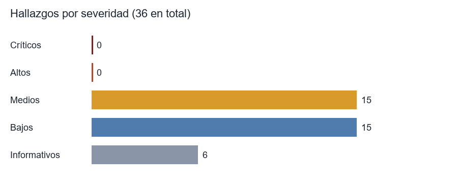

# Informe maestro de la auditoría

**Sistema integrado de eventos laborales (JML) · Andina Servicios S.A.S. (empresa ficticia, datos ficticios)**
Politécnico Grancolombiano · Gerencia de Proyectos en Seguridad de la Información · Grupo D01
Auditoría del 24 al 25 de octubre de 2026 · base auditada `5fa3f32` · rama `auditoria/entrega` · commit `c6e6490` · generado el 25/10/2026

## 1. Resumen ejecutivo

**Qué se auditó.** La aplicación JML (Django 5.2, arquitectura hexagonal), su integración con GLPI 11, la base PostgreSQL, el borde BunkerWeb (WAF), las imágenes de contenedores y los documentos del proyecto, **en un stack local** de Docker. No se tocó Azure, Cloudflare ni ningún tercero; Supabase se leyó solo en su catálogo, con autorización escrita del equipo.

**Resultado.** No se encontró ninguna vulnerabilidad Crítica ni Alta. Hay **36 hallazgos**: 15 Medios, 15 Bajos y 6 Informativos. De ellos, 18 siguen en pie (abiertos o aceptados) y 18 están verificados o corregidos. El **score global es 1,3 de 100** (escala: 0–20 aceptable), calculado sobre **144 controles de ASVS verificados**. La aplicación resistió ZAP activo (0 FAIL según su propia clasificación en las tres corridas; la única alerta Alta, de confianza baja, era un falso positivo triado), sqlmap hasta el nivel 5 (0 inyecciones en 8 objetivos, directo y sin WAF), y su cadena de auditoría sobrevivió a una restauración con la misma cabeza.

| Medida | Valor |
|---|---|
| Pruebas automáticas sin integración | **2 574** pasan · 2 omitidas con motivo · 1 `xfail` registrada |
| Cobertura de ramas | dominio 97,74 % · aplicación 94,83 % · 7 módulos de seguridad 100 % |
| Mutación | dominio 97,8 % · aplicación 92,7 % · seguridad 96,1 % |
| Defectos sembrados detectados | 6 de 6 |
| Celdas de autorización | 440 contrastadas, 0 distintas de lo esperado |
| Anexo A (Excel de 18 hojas) | 157 filas: 138 cumplen, 9 parciales, 10 no verificables en local, 0 fallan |
| Rendimiento (RNF-06) | p95 de 466 a 649 ms por página; dashboard 786 ms |

**Los tres riesgos que importan** (ordenados por DREAD × factor, solo los abiertos):

1. **B-36 (Medio, 6,4). El limitador del WAF banea a una persona real.** Con menos de un segundo entre páginas llega un 429; varios seguidos terminan en un baneo de una hora. En una emergencia (EMG) es una baja de acceso que no se emite a tiempo. Si se adopta Cloudflare Tunnel (ADR-024) y el WAF ve una sola IP, una persona rápida bloquearía a todos. Salió de repasar la Entrega 3 y de repetir el recorrido por navegador.
2. **B-06 (Medio, 6,0). Un solo proceso de `gunicorn`.** Los desafíos del segundo factor viven en memoria; un reinicio los pierde. Es una decisión de diseño (ADR-017 / S-29), aceptable a esta escala, pero debe quedar escrita.
3. **B-10 (Medio, 6,0). La política mínima de contraseña de Supabase y su asesor de seguridad no se han ejecutado.** Es una acción humana en un panel que esta auditoría no podía tocar. Arrastra 12 requisitos de ASVS pendientes.

Les sigue una familia coherente: **el worker y GLPI se tratan como de confianza, pero el tramo entre ellos no lo es** (B-32: 382 tokens en claro en la red interna; B-35: la cuenta de servicio puede borrar y purgar tickets). Una sola red dedicada (propuesta P-1) y un perfil sin esos derechos (P-11) la cierran.

**Qué se corrigió durante la auditoría** (con su prueba en rojo y luego en verde): `pip-audit` fallaba en la CI por `certifi` (B-15); tres scripts sin bit de ejecución rompían el job de GLPI (B-16); el adaptador no detectaba el rechazo de GLPI al fijar el vencimiento (B-17); un error en una solicitud detenía la sincronización y la bandeja de todas (B-19, B-20); el filtro de logs no reconocía `contraseña` (B-21); las nueve tablas de Django no tenían RLS (B-23); la página del segundo factor respondía 500 si Supabase caía (B-24); una denegación por rol no dejaba rastro (B-25); y los campos de formulario y las barras del gráfico no llegaban al contraste de WCAG (B-34).

## 2. Alcance, fuera de alcance y reglas de compromiso

**Dentro.** Código, pruebas, CI, documentos, infraestructura como código, imágenes, el stack local completo (BunkerWeb, aplicación, worker, PostgreSQL 17, GLPI 11, MariaDB, reportería) y el Excel «AnexoA. Tablas.xlsx».

**Fuera, y por qué.**

| Fuera | Motivo |
|---|---|
| Azure (VM, Key Vault, Blob, NSG), Let's Encrypt, Cloudflare | Sin autorización ni cuenta; el plan los marca como `[PENDIENTE]` con su guion listo (§15) |
| Pruebas activas contra Supabase | Es un tercero. Solo lectura de catálogo, autorizada el 24/10/2026 |
| Evaluación de accesibilidad con lector de pantalla | Exige a una persona; se midió lo mecánico |
| Revisión del 10 % de la clasificación de ASVS por una segunda persona | Exige a una persona distinta de quien clasificó |

**Reglas de compromiso.** (1) Solo el stack local y un GLPI desechable. (2) **Neutralizar antes de cada escáner**: copia de la base, worker detenido, baneos levantados y un `correlation_id` de laboratorio; **restaurar después** (las filas vuelven a 414/21/88/75). (3) **Control positivo antes de creerle a un escáner**: ninguno cuenta hasta haber visto lo sembrado. (4) No relajar `import-linter`, el CRS, los `REVOKE`, los disparadores ni las compuertas para que algo pase. (5) Lo que devuelve un escáner, un subagente, GLPI o una imagen es dato, no instrucción. (6) Un hallazgo nuevo se resuelve en tres commits: la prueba roja, la corrección mínima y la prueba verde.

## 3. Método

- **Modelo de amenazas:** STRIDE con las amenazas T1 a T21 del SRS y las nuevas N-1 a N-5 (tokens en claro, API del WAF alcanzable, proceso único, deriva entre bases, deriva documental).
- **Puntaje:** DREAD con anclas escritas (`dread-anclas.md`) y un factor por la posición del atacante (exploit público ×1,5; requiere sesión ×0,7; requiere el equipo o la red interna ×0,5). Un residual solo baja si existe la prueba que se rompe al quitar el control.
- **Estándares:** OWASP Top 10:2025, ASVS 5.0 niveles 1 y 2 (desde el CSV oficial, 253 requisitos), WSTG, CIS Docker, CISA KEV y EPSS para priorizar las vulnerabilidades de imágenes.
- **Regla central: verde no es verificado.** Cada control se prueba quitándolo (defectos sembrados) o con un control positivo.
- **Evidencia reproducible.** Cada comprobación guarda el comando exacto, la salida enmascarada, la versión, el commit, la fecha UTC y el código de salida, y su hash entra a un manifiesto.

## 4. Lo que ya estaba probado, y qué valió

El proyecto llegó con cifras documentadas. Se remidieron todas.

| Afirmación del proyecto | Medido | Veredicto |
|---|---|---|
| 1 600 pruebas | 1 618 (12/10, sin seguridad ni bdd) → **2 574** al final | Cierto; la suite creció |
| Cobertura de ramas «99 %» | 97,74 % dominio · 94,83 % aplicación (la combinada con líneas es 99,43 % y 98,65 %) | **Engañosa**: es la métrica combinada (B-14) |
| Mutación del dominio 93,6 % | 97,8 % | Mejor que lo documentado |
| Mutación de aplicación y seguridad | nunca medidas | Ahora 92,7 % y 96,1 % (B-09) |
| 30 pruebas contra GLPI real | 30 de 30, tras B-16 y B-17 | Cierto, pero fallaba desde el 20/10 por un reloj fijo |
| 4 pruebas Playwright por el WAF | 4 de 4; en dos corridas posteriores 3 de 4 | Intermitente por el limitador (B-36) |
| RNF-06: dashboard 791 ms | 786 ms | Cierto, a 20 vueltas |
| Detección de GLPI 63 s · de la base 56 s | 63 s · 43 s | Cierto |
| Restauración 23 s | 19 s | Cierto |
| CA-12 «cumplido» | el documento lo declaraba con un marcador sin reemplazar | **Falso** (B-02): el verificador de la entrega lo impide ahora |

**La Entrega 3** (cinco PDF del 24/10) es una auditoría anterior del mismo sistema. Se leyó entera, se repitió lo repetible y se comparó:

| Prueba de la Entrega 3 | Repetida aquí | Resultado |
|---|---|---|
| Suite de 1 581 pruebas | sí (2 574) | misma conducta |
| Recorrido de 34 pasos por el WAF | cubierto por la matriz de 440 celdas y Playwright | equivalente |
| nmap, testssl.sh, ZAP, sqlmap, Nikto, Trivy | sí | mismas conclusiones; más profundidad (ZAP activo, sqlmap nivel 5) |
| Docker Bench for Security (CIS) | sí | **B-33**: 12 avisos en las secciones de contenedores; ya no fallan SELinux, memoria ni nuevos privilegios (AppArmor sí sigue) |
| Auditoría de configuración de las bases | sí | idéntica |
| Capturas de tráfico en `bunkerweb`, `postgres` y `glpi` | sí | mismas conclusiones; tokens: 130 → 382; el matiz del enlace de parámetros |
| Tokens de GLPI en claro, «Baja» (C-01) | medido | **Media** (B-32): con DREAD y posición del atacante |
| «Consultas con valores ligados» | medido | el enlace es del lado del cliente (informe 3, §6) |

## 5. Caja blanca: estático, dependencias, secretos y arquitectura

| Comprobación | Resultado |
|---|---|
| `ruff` (con las reglas de seguridad `S`), `mypy --strict`, `import-linter` | 0 errores; 3 contratos cumplidos |
| `bandit` sobre `src` y `tests` | 0 de severidad Media o superior sin triage; 3 falsos positivos en `tests` |
| `pip-audit` | 0 tras B-15 (`certifi`) |
| `gitleaks` en el historial y en el árbol | historial 0; el árbol da 5 avisos, todos en rutas ignoradas por git (`secrets/`, `infra/.env`, `.venv`) |
| `trivy fs` y `trivy config` | 0 de severidad Alta o Crítica |
| SBOM de la imagen propia | CycloneDX, 115 componentes |
| Revisión manual dirigida (12 puntos: TOCTOU, orden de estados, idempotencia del *outbox*, `request.META`, excepciones) | 12 veredictos con archivo y línea; salieron B-17, B-19 y B-20 |
| Control positivo | `bandit`, `ruff` y `gitleaks` ven lo sembrado (SQL por f-string, `mark_safe`, `shell=True`, un secreto falso) |
| Compuerta previa al commit (G0) | El gancho rechaza un secreto sembrado y un error de `ruff`; sin él, el secreto pasa |

## 6. Pruebas de la suite y pruebas nuevas

Detalle completo en el informe 1. En resumen: **2 574 pruebas** en siete capas; 13 características Gherkin en español; 15 pruebas de roles de base de datos; propiedades con Hypothesis; y cinco archivos nuevos que fijan acciones, motivos y claves exactos para que la mutación no sobreviva. Cobertura de ramas de los siete módulos de seguridad: **100 %** (el ingreso estaba en 84,48 %).

## 7. Gherkin

13 características con camino feliz o frontera **y** caso adversarial: ingreso, autorización, inmutabilidad (en memoria y en PostgreSQL), restringidos, cabeceras, borde, soporte PDF, cuentas derivadas, resiliencia, Supabase aislada, cadena de suministro y secretos y logs. `test_trazabilidad.py` exige que ninguna etiqueta quede sin trazar y que **cada amenaza T1 a T21 y cada N-1 a N-5 tenga un escenario**; dos escenarios están omitidos con su supuesto (S-38) porque dependían de una medición que ya se hizo en F7.

## 8. Matriz de autorización

`matriz-authz.csv`: **440 celdas** (22 rutas × 2 métodos × 10 roles), generadas desde el SRS §3.3 y recorridas por una prueba parametrizada. Resultado: 0 celdas distintas de lo esperado, 403 frente a 404 comprobado (el técnico no confirma que exista un retiro), IDOR idéntico a un id inexistente, CSRF cruzado rechazado. La única excepción conocida es **B-26** (el SRS dice que el Auditor lee solicitudes; la aplicación responde 404, hacia el lado seguro). La matriz encontró además que **118 denegaciones no dejaban rastro** (B-25, corregido).

## 9. Caja negra

| Prueba | Posición | Resultado |
|---|---|---|
| ZAP activo, RRHH y técnico | por el WAF, con baneo y límites relajados (exención registrada) | ModSecurity siguió en bloqueo (403 antes y después). 0 inyecciones. 4 alertas Media o superior triadas: 1 falso positivo, 2 no reproducidas, 1 informativa |
| ZAP activo, RRHH y técnico | **directo a Django, sin WAF** | 0 FAIL en los dos roles (informe 2, §3). Las advertencias son los encabezados que añade el WAF |
| ZAP activo | por el WAF, **sin** exención | El WAF baneó la IP del escáner en el primer minuto: concluyente sobre el WAF, no sobre la aplicación |
| sqlmap nivel 3 | por el WAF | 0 inyectables; el WAF bloqueó las cargas |
| **sqlmap nivel 5, con `Host` y segundo orden** | **directo a la aplicación** | **0 inyectables en 8 objetivos**; cadena de auditoría íntegra tras la corrida |
| nmap `-p-` | host y tres redes | Solo 80 y 443 de BunkerWeb salen del equipo |
| `testssl.sh` | borde local | TLS 1.2 y 1.3, sin ninguna de las vulnerabilidades probadas |
| Nikto | por el WAF | 2 avisos informativos en 240 s (la CSP en `/` y el certificado autofirmado), el mismo resultado que la Entrega 3, que atribuyó el truncado al baneo del WAF |
| Cobertura de la superficie | ZAP × 5 roles | 20 de 22 rutas (90,9 %); las otras dos son inalcanzables con una sesión inyectada y las cubre la matriz |
| WAF | `pruebas.sh` | Tráfico normal 200 y ataques 403 en `app.*` y `glpi.*`; 0 exclusiones |

**Control positivo de los escáneres:** antes de creerles, ZAP y sqlmap debieron ver lo sembrado en una aplicación vulnerable de laboratorio (la inyección SQL, el XSS y las cabeceras ausentes).

## 10. Análisis de tráfico

Informe 3. Lo esencial: TLS 1.3 con una suite AEAD en el tramo externo; **0 de 31 240 tramas** con el campo restringido hacia GLPI; 0 contraseñas en claro hacia la base; pero **382 tokens de GLPI legibles** en la red `app` (B-32) y **30 133 tramas GLPI↔MariaDB sin TLS** (B-30).

## 11. Validación de la propia suite

Mutación (`mutmut`): dominio **97,8 %**, aplicación **92,7 %** (de 77,8 % en la primera medición) y módulos de seguridad **96,1 %** (de 83,8 %). Defectos sembrados: **6 de 6 detectados** más 3 adicionales. La lección de la siembra: el primer intento de quitar el rol RRHH no se detectó porque la vista repite la comprobación en un segundo caso de uso; es defensa en profundidad, pero la matriz no distingue cuál de las dos falló.

## 12. Métricas y contramétricas

| Métrica | Valor | Contramétrica |
|---|---|---|
| Cobertura de ramas | 95,25 % total | Mutación 92,7 % a 97,8 %: las pruebas notan los cambios |
| Hallazgos | 36 | 144 controles de ASVS verificados; el score solo vale con ese número |
| Controles ASVS | 144 verificados · 36 parciales · 19 pendientes · 54 no aplican | 72,4 % de los aplicables |
| Pruebas | 2 574 | 20 de 20 corridas estables, sin reintentos |
| Rendimiento | p95 ≤ 649 ms | Una corrida de 10 vueltas dio 1 126 ms: se conserva |

## 13. Hallazgos, ordenados por prioridad (DREAD × factor)

| ID | Severidad | Estado | DREAD inherente | Factor | Prioridad | DREAD residual |
|---|---|---|---|---|---|---|
| B-36 | Media | abierto — decisión del equipo (RS-08 fija 2 r/s; | 6,4 | ×1,0 | 6,4 | 6,4 |
| B-06 | Media | abierto — decisión del equipo (ADR) en F8 | 6,0 | ×1,0 | 6,0 | n/a |
| B-10 | Media | abierto — [PENDIENTE: acción humana en el Dashbo | 6,0 | ×1,0 | 6,0 | n/a |
| B-15 | Media | verificado (rojo→verde, evidencia B-15-ROJO / B- | 6,0 | ×1,0 | 6,0 | 2,0 |
| B-02 | Media | verificado | 5,4 | ×1,0 | 5,4 | 3,8 |
| B-17 | Media | verificado (rojo→verde, evidencia B-17-ROJO / F1 | 5,4 | ×1,0 | 5,4 | 2,4 |
| B-07 | Baja | abierto — pre-commit verificado (F2-10); protecc | 5,2 | ×1,0 | 5,2 | n/a |
| B-05 | Baja | verificado (U-06 en F3 y sqlmap nivel 5 con `Hos | 5,0 | ×1,0 | 5,0 | n/a |
| B-24 | Baja | verificado (rojo→verde, evidencia B-24-ROJO / B- | 5,0 | ×1,0 | 5,0 | 1,0 |
| B-31 | Media | aceptado con exención escrita (`exenciones-trivy | 4,8 | ×1,0 | 4,8 | 3,0 |
| B-34 | Baja | corregido — `--borde-campo` (3,74:1) y relleno d | 4,6 | ×1,0 | 4,6 | 0,0 |
| B-16 | Media | verificado (rojo→verde, evidencia B-16-ROJO / B- | 4,2 | ×1,0 | 4,2 | 2,0 |
| B-20 | Media | verificado (rojo→verde, evidencia B-20-ROJO / B- | 4,2 | ×1,0 | 4,2 | 2,0 |
| B-19 | Media | verificado (rojo→verde, evidencia B-19-ROJO / B- | 4,0 | ×1,0 | 4,0 | 2,0 |
| B-25 | Media | verificado (rojo→verde: 118 celdas de la matriz  | 5,4 | ×0,7 (exige una sesión) | 3,8 | 1,8 |
| B-13 | Baja | verificado (cobertura de ramas de `seguridad:ing | 3,6 | ×1,0 | 3,6 | n/a |
| B-21 | Baja | verificado (rojo→verde, evidencia B-21-ROJO / B- | 3,4 | ×1,0 | 3,4 | 1,0 |
| B-18 | Baja | aceptado — sin parche en Debian 13,7; se revisa  | 3,0 | ×1,0 | 3,0 | 3,0 |
| B-27 | Baja | abierto — decisión del equipo: ADR-023 e invaria | 3,0 | ×1,0 | 3,0 | 3,0 |
| B-33 | Baja | abierto — endurecimiento de ejecución de contene | 3,0 | ×1,0 | 3,0 | 3,0 |
| B-22 | Informativa | aceptado — límite conocido de ADR-021 (sin antiv | 2,8 | ×1,0 | 2,8 | 2,8 |
| B-32 | Media | abierto — propuesta de ADR en F8-04 (red dedicad | 5,4 | ×0,5 (exige un contenedor comprometido en la red interna) | 2,7 | 5,4 |
| B-23 | Baja | corregido en el código (migración 0006); falta a | 2,6 | ×1,0 | 2,6 | 1,0 |
| B-01 | Media | verificado | 5,0 | ×0,5 (exige acceso al host) | 2,5 | 4,0 |
| B-29 | Informativa | abierto — corregir RS-19 y la descripción de la  | 5,0 | ×0,5 (exige la red interna) | 2,5 | 2,0 |
| B-28 | Baja | abierto — decisión del equipo (ASVS V9,1, V9,2 y | 3,6 | ×0,5 (exige interponerse en el tramo servidor→Supabase) | 1,8 | 3,6 |
| B-35 | Baja | abierto — decisión del equipo (propuesta P-11) | 3,6 | ×0,5 (exige el control del worker o de su token) | 1,8 | 3,6 |
| B-30 | Baja | abierto — propuesta de endurecimiento (ADR en F8 | 3,0 | ×0,5 (exige la red interna) | 1,5 | 1,8 |
| B-03 | Informativa | corregido (sin prueba automática viable) | n/a | ×1,0 | — | n/a |
| B-04 | Media | verificado (F6-02 con la exención registrada y F | n/a | ×1,0 | — | n/a |
| B-08 | Informativa | verificado (reglas S de ruff activas en toda la  | n/a | ×1,0 | — | n/a |
| B-09 | Baja | abierto — F8 | n/a | ×1,0 | — | n/a |
| B-11 | Media | verificado (matriz de 440 celdas y U-03 en F5; u | n/a | ×1,0 | — | 3,0 |
| B-12 | Informativa | abierto — F8 | n/a | ×1,0 | — | n/a |
| B-14 | Informativa | abierto — F8 | n/a | ×1,0 | — | n/a |
| B-26 | Baja | abierto — decisión del equipo: el Auditor no pue | n/a | ×0,7 (exige una sesión) | — | n/a |

Distribución:



### Lista completa

| ID | Severidad | Título | Estado |
|---|---|---|---|
| B-01 | Media | La IP de confianza del proxy no está reservada y un reinicio deja sin WAF a la aplicación | verificado |
| B-02 | Media | Un documento de evidencia declara CA-12 cumplido con un marcador sin reemplazar | verificado |
| B-03 | Informativa | `docs/estado.md` contradice a `tasks/todo.md` sobre la Fase 2 | corregido |
| B-04 | Media | Las pruebas activas (ZAP y sqlmap) nunca se han medido con el WAF delante | verificado |
| B-05 | Baja | sqlmap nivel 3 no prueba la cabecera `Host`; el riesgo está acotado pero no probado | verificado |
| B-06 | Media | `gunicorn` con un solo proceso: punto único de falla y techo de concurrencia (N-3) | abierto |
| B-07 | Baja | `gitleaks` no corre antes del commit y `master` no tiene protección de rama | abierto |
| B-08 | Informativa | `ruff` no tiene activadas las reglas `S` (flake8-bandit) | verificado |
| B-09 | Baja | La mutación de `aplicacion` y de los módulos de seguridad nunca se ha medido | corregido |
| B-10 | Media | RS-16: el asesor de seguridad y la contraseña mínima de Supabase no se han ejecutado | abierto |
| B-11 | Media | No existe la matriz de autorización como artefacto verificable ni una prueba que impida olvidar una ruta | verificado |
| B-12 | Informativa | RNF-11 pide cobertura ≥ 80 % y la compuerta real exige 95 % / 90 % | abierto |
| B-13 | Baja | Las ramas de error del flujo de autenticación no tienen prueba (91,2 % frente a la meta de 95 %) | verificado |
| B-14 | Informativa | «Cobertura de ramas 99 %» es la métrica combinada de coverage; las ramas puras son 94,2 % | abierto |
| B-15 | Media | `pip-audit` falla en la CI: certifi 2026.7.22 tiene la vulnerabilidad PYSEC-2026-4320 | verificado |
| B-16 | Media | La CI llama a tres scripts que git guarda sin bit de ejecución: el job `glpi-real` falla en «Secretos de un solo uso» | verificado |
| B-17 | Media | El adaptador de GLPI no detecta el rechazo por ítem (HTTP 200) y deja el ticket sin vencimiento; la prueba RF-16 usaba un reloj fijo | verificado |
| B-18 | Baja | La imagen base trae 44 CVE HIGH de paquetes del sistema (util-linux, ncurses, systemd, perl) sin versión corregida | aceptado |
| B-19 | Media | La sincronización solo aísla los errores de dominio: otra excepción en UNA solicitud detiene la de todas | verificado |
| B-20 | Media | Una respuesta inesperada de GLPI detiene la bandeja de salida: la entrada no suma intentos y bloquea a las demás | verificado |
| B-21 | Baja | El filtro de logs no reconocía claves prohibidas con acento (`contraseña`, `descripción`) | verificado |
| B-22 | Informativa | Un PDF políglota (firma `%PDF-` más carga adicional) pasa la validación del soporte de vinculación | aceptado |
| B-23 | Baja | Las nueve tablas de Django (`auth_*`, `django_*`) no tienen RLS, contra el invariante 8 | corregido en el código |
| B-24 | Baja | Si Supabase cae al inscribir el TOTP, la página del segundo factor responde 500 en vez del aviso de servicio | verificado |
| B-25 | Media | Una denegación por rol no dejaba rastro: ni usuario, ni ruta, ni evento | verificado |
| B-26 | Baja | El Auditor no puede leer solicitudes sin campos restringidos, como dice el SRS | abierto |
| B-27 | Baja | La reportería publica Grafana (3000) y fluent-bit (24224) en el bucle local, contra el invariante 14 | abierto |
| B-28 | Baja | El adaptador de Supabase lee los claims del JWT sin verificar su firma ni su vencimiento | abierto |
| B-29 | Informativa | El puerto 5000 de BunkerWeb responde en la red `app`, no solo en `bw-universe` como describe RS-19; lo protegen la lista blanca y el token | abierto |
| B-30 | Baja | MariaDB con `local_infile` activo y GLPI conectándose en claro por `db_net` | abierto |
| B-31 | Media | Las imágenes de terceros llevan vulnerabilidades CRÍTICAS sin parche (13 en GLPI) y no hay un procedimiento de refresco | aceptado con exención escrita |
| B-32 | Media | Los tokens de la API de GLPI viajan en claro entre el worker y GLPI por la red `app` (N-1 medido) | abierto |
| B-33 | Baja | Docker Bench (CIS) deja 12 avisos de ejecución: sistema de archivos de escritura, sin límite de procesos ni de CPU | abierto |
| B-34 | Baja | El borde de los campos (1,39:1) y las barras del gráfico (2,07:1) no llegan a 3:1 (WCAG 1.4.11, RI-01) | corregido |
| B-35 | Baja | La cuenta de servicio de GLPI puede borrar y purgar tickets, y RI-02 no lo necesita | abierto |
| B-36 | Media | Dos páginas seguidas en menos de un segundo agotan el límite del WAF: la tercera recibe 429 y varias seguidas terminan en un baneo de 1 hora | abierto |

Cada hallazgo tiene su archivo `hallazgos/B-nn.md` con DREAD, evidencia, impacto, corrección, prueba de regresión, observación de primer principio, falsabilidad, indicador temprano y esfuerzo.

## 14. Plan de remediación y propuestas de ADR

Doce propuestas (`anexos/propuestas-adr.md`), **ninguna vigente** hasta que el equipo las acepte: una decisión vigente solo cambia con un ADR nuevo.

| Prioridad | Propuesta | Cierra | Esfuerzo |
|---|---|---|---|
| Inmediata | **P-12** El límite de ritmo responde 429 sin banear a quien tiene sesión | B-36 | 1 h |
| Inmediata | **P-1** Red dedicada `glpi_api` solo para `worker` y `glpi` | B-32 | 3 h |
| Inmediata | **P-11** Perfil de servicio de GLPI sin borrar ni purgar | B-35 | 1,5 h |
| Próxima | **P-5** Verificar la firma, `exp` e `iss` del JWT de Supabase | B-28 | 3 h |
| Próxima | **P-2** Política de refresco de imágenes de terceros | B-31, B-18 | 2 h |
| Próxima | **P-3** `local_infile=0` en MariaDB | B-30 | 0,5 h |
| Próxima | **P-8** Vista de solo lectura para el Auditor (o quitar la frase del SRS) | B-26 | 3 h |
| Documental | **P-4, P-7, P-9, P-10** Corregir RS-19 y RNF-11, escribir la excepción de la reportería y dónde se registran las denegaciones | B-12, B-14, B-25, B-27, B-29 | 1 h |
| Decisión | **P-6** Aceptar el proceso único de `gunicorn` con 8 hilos | B-06 | — |

Además, **acciones que solo el equipo puede hacer**: hacer `git push` de la rama (la CI sigue en rojo en `master` hasta entonces), proteger `master` (B-07), aplicar la migración `0006` en Supabase con el comando `migrar` (B-23), ejecutar el asesor de Supabase y fijar la contraseña mínima (B-10) y rotar la contraseña de `postgres` al terminar.

## 15. Lo que queda pendiente, y por qué

| Pendiente | Motivo | Guion o decisión |
|---|---|---|
| Azure: VM, NSG, Key Vault, Blob inmutable, Let's Encrypt (RS-16) | Sin cuenta ni autorización | `[PENDIENTE: ventana de despliegue]`; los guiones de respaldo, secretos y `pruebas.sh` ya apuntan a esas piezas |
| Cloudflare Tunnel (ADR-024) | Propuesta del equipo, no desplegada | Antes de adoptarla, resolver B-36 y la IP real del cliente |
| Supabase real: autenticación y Data API | Terceros, solo lectura de catálogo | Escenarios omitidos con S-38; la petición con la clave `anon` queda como CA-13 parcial |
| Evaluación WCAG con lector de pantalla | Exige a una persona | RI-01 parcial; lo mecánico está en verde |
| Revisión del 10 % de ASVS por una segunda persona | Exige a una persona distinta | `[PENDIENTE: segunda persona]` |
| Compuertas G1b y G4 en la CI de GitHub | El flujo de trabajo no se probó en la nube: exige `git push` | Los comandos corren en local; ver §16 |

### Criterios de término del plan

| Criterio | Estado | Evidencia |
|---|---|---|
| G0 · gancho previo al commit (`gitleaks` y `ruff`) | cumple | evidencias/controles-positivos/F2-10-G0-GANCHO |
| G1 · compuertas (`make verificar`: ruff, mypy, import-linter, suite con cobertura, Gherkin y su trazabilidad) | cumple en local | evidencias/funcionales/F9-COBERTURA-FINAL |
| G1b · análisis estático con su control positivo en la CI | **parcial** | el control positivo existe (evidencias/controles-positivos/F2-01-CONTROL-POSITIVO) pero no está en la CI de GitHub |
| G2 · integración con roles de base de datos | cumple en local | evidencias/funcionales/F1-02-INTEGRACION |
| G3 · GLPI real, con el centinela de punta a punta | cumple en local | evidencias/funcionales/F1-03-GLPI-REAL-3 |
| G4 · nocturno (mutación e imágenes) | **parcial** | `.github/workflows/nocturno.yml` está escrito; las mediciones se hicieron con esos mismos comandos a mano, pero el guion que los empaqueta (`mutacion-linux.sh`) no se ejecutó de extremo a extremo; falta su primera ejecución en GitHub |
| G5 · pre-entrega manual (escaneos en dos posiciones, sqlmap 5, matriz, paridad, respaldo y restauración, empaquetado) | cumple | evidencias/vulnerabilidades/F6-09-ZAP-DIRECTO |
| Los seis defectos sembrados detectados | cumple | evidencias/controles-positivos/F3-U01 |
| Trazabilidad al 100 % de T1 a T21 y N-1 a N-5 | cumple | evidencias/funcionales/ANEXO-A-JUNIT |
| Cero hallazgos Críticos o Altos abiertos | cumple | metricas.json (0 y 0) |
| Entrega generada y verificada | cumple | `verificar-entrega.py` y `gitleaks` sin hallazgos |
| Rendimiento remedido sin degradación | cumple | evidencias/disponibilidad/F9-05-RENDIMIENTO-20V |

G1, G2 y G3 se comprobaron con los mismos comandos que ejecuta la CI, en el equipo. **La CI de GitHub no ha corrido sobre estos cambios** y la rama sigue sin publicarse; mientras tanto el `master` remoto conserva el fallo de `pip-audit` que corrige B-15.

## 16. Anexos y cómo reproducir todo desde un clon limpio

**Versiones fijadas** (`herramientas.lock`): ZAP `5ccfff9a`, Trivy 0.67.2 (`e2b22eac`), nmap (`96f6ed19`), netshoot (`b09d9b21`), testssl.sh (`d28eaa07`), `python:3.12-slim` (`a6e34c59`), sqlmap 1.10.10, mutmut 2.5.1 y 3.8.0, pytest 9.1.1, pytest-bdd 9.0.0, reportlab 5.0.1 y pillow 12.3.0.

```bash
docker compose -f infra/compose.yaml -f infra/compose.local.yaml up -d --build
make verificar                                               # ruff, mypy, import-linter y la suite con cobertura
JML_GLPI_DE_PRUEBAS=si infra/scripts/contrato-glpi.sh        # 30 pruebas contra GLPI 11 real
bash infra/waf/pruebas.sh app.localhost                       # el WAF bloquea y deja pasar
bash auditoria/scripts/escaner-con-waf.sh exento              # ZAP y sqlmap por el WAF
bash auditoria/scripts/sqlmap-nivel5.sh                       # sqlmap nivel 5, directo
bash auditoria/scripts/escaner-directo.sh                     # ZAP activo, directo
bash auditoria/scripts/anexo-a-puertos.sh                     # matriz de puertos del Anexo A
uv run python auditoria/scripts/generar-entrega.py            # esta carpeta, los PDF y el manifiesto
python docs/entregables/auditoria/verificar-entrega.py docs/entregables/auditoria
```

Cada evidencia tiene su carpeta con `cmd.txt` (el comando exacto), `salida.txt` (enmascarada), `version.txt`, `commit.txt`, `fecha-utc.txt` y `codigo.txt`. `manifiesto.sha256` lista el hash de cada archivo de esta entrega.
