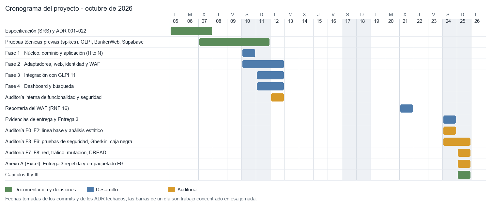

# Capítulo II. Ejecución

**Sistema integrado de eventos laborales (JML) · Andina Servicios S.A.S. (empresa ficticia, datos ficticios)**
Politécnico Grancolombiano · Gerencia de Proyectos en Seguridad de la Información · Grupo D01
25 de octubre de 2026

> **Nota para el equipo.** Este capítulo y el siguiente se redactaron a partir de la evidencia del repositorio (commits, pruebas, informes y mediciones). El texto de los capítulos I y los objetivos formales del proyecto no estaban en el repositorio; por eso los «objetivos» que se evalúan en la sección 2.3 son los diez puntos del alcance del SRS (v2.4). Si sus objetivos general y específicos están redactados de otra forma, reemplace la columna «Objetivo» de la tabla 2.3 y deje las otras columnas, que son los resultados.

## 2.1 Desarrollo ingenieril y cronograma

El proyecto construye y audita un sistema que formaliza la interacción entre Recursos Humanos y Tecnología durante el ciclo de vida laboral de los colaboradores (ingreso, vacaciones, cambio de departamento o sucursal, retiro y emergencia, el modelo *Joiner–Mover–Leaver*). La aplicación web propia registra y aprueba cada evento y lo convierte en un ticket por cola de TI (AD, Comunicaciones, Licencias e Inventario) en GLPI 11, donde los técnicos trabajan. La aplicación **no ejecuta acciones sobre directorios ni servicios de identidad**: las hacen personas y quedan documentadas en la solución del ticket.

### Diagrama de Gantt

El cronograma se reconstruyó con las fechas reales del repositorio (primer commit el 10/10/2026, más de 170 commits) y de los documentos del proyecto (ADR fechados el 05, 07, 10 y 11/10/2026).

### Actividades y entregables

| Fase | Fechas (2026) | Actividades | Entregable verificable |
|---|---|---|---|
| Especificación y decisiones | 05 al 07/10 | Requisitos funcionales, no funcionales, de datos, de interfaces y de seguridad; ADR 001 a 022 | `docs/SRS.md` (v2.4), `docs/decisiones.md` (30 ADR) |
| Pruebas técnicas previas (*spikes*) | 07 al 11/10 | GLPI 11 por API v1 (ADR-014), BunkerWeb, Supabase, mutación, revisión externa del núcleo | `docs/spikes/` (7 documentos) |
| Fase 1 · Núcleo | 10/10 | `dominio` y `aplicacion` completos con dobles en memoria, sin Django ni red; congelado en el Hito N | Etiqueta `nucleo-v1` |
| Fase 2 · Adaptadores y seguridad | 10 al 12/10 | Persistencia sobre el ORM, web, identidad (Supabase Auth con TOTP), worker, soportes, BunkerWeb | Suite de contrato que el doble y el adaptador real pasan sin cambios |
| Fase 3 · Integración con GLPI | 11 al 12/10 | Cliente `httpx`, configuración de GLPI como código (categorías, grupos, reglas, SLA, plantillas), bandeja de salida con reintentos | 30 pruebas contra GLPI 11 real |
| Fase 4 · Dashboard y búsqueda | 11 al 12/10 | Indicadores para técnicos sin tiempo real, búsqueda de cuentas, ficha | RNF-06 medido |
| Auditoría interna | 12/10 | Revisión de funcionalidad y seguridad: 12 hallazgos, todos corregidos | `docs/auditoria-2026-10-12.md` |
| Reportería del WAF | 21/10 | Fluent Bit, Loki y Grafana (RNF-16) | `infra/reporteria/` |
| Fase 5 · Evidencias de entrega | 24/10 | RNF-06, CA-11, CA-12, Playwright, secretos con SOPS y la Entrega 3 | `docs/evidencia/`, cinco documentos de la Entrega 3 |
| Auditoría F0 a F2 | 24/10 | Preparación, línea base medida y análisis estático con control positivo | Hallazgos B-01 a B-08 y B-13 a B-20 |
| Auditoría F3 a F6 | 24 al 25/10 | Pruebas nuevas de seguridad, Gherkin, matriz de autorización, defectos sembrados, caja negra | 440 celdas y 13 características |
| Auditoría F7 a F8 | 25/10 | Infraestructura, red y tráfico; mutación; DREAD, score global y propuestas de ADR | Mutación de tres objetivos |
| Anexo A, Entrega 3 y empaquetado | 25/10 | Verificación de las 18 hojas del Excel, repaso de la versión anterior, informes y PDF | `docs/entregables/auditoria/` verificada |

### Tamaño de lo construido

| Medida | Valor |
|---|---|
| Commits en la rama de trabajo | más de 170 |
| Código de producción (`src`, Python) | 91 archivos · 9 459 líneas no vacías |
| Pruebas (`tests`, Python) | 134 archivos · 17 419 líneas · 13 características Gherkin |
| Guiones de la auditoría | 26 archivos de Python · 4 250 líneas, más los de shell |
| Pruebas automáticas que pasan | 2 574 (sin integración); 251 de integración con PostgreSQL; 30 contra GLPI 11 real; 4 de navegador |
| Decisiones de arquitectura | 30 ADR (24 aceptadas, 5 reemplazadas, 1 propuesta) |
| Requisitos | 40 funcionales, 16 no funcionales, 20 de seguridad, 12 de datos, 6 de interfaces, 21 criterios de aceptación y 26 amenazas (T1 a T21 y N-1 a N-5) |

## 2.2 Descripción detallada del desarrollo

### Arquitectura y orden de construcción

El sistema sigue una **arquitectura hexagonal**. Las reglas del negocio viven en `dominio` (solo la biblioteca estándar) y los casos de uso en `aplicacion` (solo importa `dominio`); los adaptadores (web, persistencia, GLPI, identidad, worker) dependen hacia adentro y nunca al revés. `import-linter` verifica los tres contratos en cada integración y **no se relajó ninguno** para que un cambio pasara.

El orden fue deliberado: el núcleo se construyó **primero**, completo y con dobles en memoria, antes de escribir un adaptador, una vista, una migración o un contenedor, y se congeló en el Hito N. Cada puerto tiene una **suite de contrato** parametrizada: el doble en memoria y, más tarde, el adaptador real la pasan sin cambios. Un adaptador que necesitara cambiar la suite sería la señal de que el puerto está mal. El doble en memoria de las consultas del dashboard es el **oráculo** de la consulta SQL.

### Decisiones que dieron forma al sistema

| Decisión | Efecto |
|---|---|
| GLPI es un adaptador y fuente de la verdad del estado de cada ticket (ADR-001, 016) | La aplicación nunca llama a GLPI dentro de una petición web; solo el worker lo hace |
| Sin acciones sobre directorios (ADR-019) | Ningún código llama a LDAP, Graph ni Samba; las acciones técnicas las hace una persona |
| Deduplicación con índice único parcial (ADR-006) | La base de datos, no el código, impide dos solicitudes abiertas del mismo tipo para la misma persona |
| Auditoría de solo inserción con cadena de hashes (ADR-007) | `hash = SHA-256(hash_anterior ‖ contenido)`; alterar un registro rompe la verificación |
| Supabase Auth con TOTP mediado por el servidor (ADR-017) | La sesión de Django se crea solo después del segundo factor |
| BunkerWeb como WAF y proxy inverso (ADR-023) | ModSecurity con el OWASP CRS 4 en modo bloqueo delante de la aplicación y de GLPI |
| Dueño del esquema separado de `app_backend` (ADR-028) | La aplicación no puede modificar su propio esquema ni la auditoría |

### Los flujos que el sistema ejecuta

1. **Solicitud.** La registra un colaborador autenticado o directamente RRHH, con validación en el servidor y fecha efectiva.
2. **Aprobación y emisión.** RRHH aprueba o rechaza con justificación. Una solicitud aprobada no se modifica (disparador en la base).
3. **Tickets.** El dominio genera un ticket por cola con su lista de verificación, prioridad, vencimiento y, si aplica, fecha programada; un worker los crea en GLPI mediante una bandeja de salida con reintentos e idempotencia.
4. **Ejecución.** Los técnicos resuelven en GLPI con una plantilla de solución obligatoria.
5. **Cierre y registro.** La sincronización, cada 5 minutos, trae el estado; la solicitud se cierra cuando todos sus tickets de cierre están resueltos con solución y, en Inventario, con acta; el estado de las cuentas se **deriva** de los tickets resueltos.

### Cómo se aseguró la calidad mientras se construía

- **Pruebas primero.** Para cada defecto, primero la prueba que lo reproduce (en rojo), luego la corrección mínima (en verde), en commits separados con el identificador del requisito.
- **Compuertas.** `ruff` con las reglas de seguridad, `mypy --strict`, `import-linter` y la suite con cobertura de ramas (dominio ≥ 95 % y aplicación ≥ 90 %) en cada integración; `gitleaks`, `pip-audit` y `bandit` en un trabajo aparte; Trivy antes de publicar la imagen.
- **Supuestos escritos.** Todo lo que el SRS dejó abierto se registró con un identificador (S-01 a S-40) y una prueba que lo nombra.
- **Lecciones.** 65 lecciones numeradas, más las de la auditoría, registradas en `tasks/lessons.md` para no repetir errores.

### La auditoría como parte de la ejecución

Con el sistema construido, se ejecutó una auditoría de seguridad y calidad en diez fases (F0 a F9) bajo un plan escrito, con un ciclo de doce pasos por ítem (leer, planear, buscar, neutralizar, control positivo, ejecutar con evidencia, romper, clasificar, actualizar, confirmar, compuerta, siguiente). Resultado: **36 hallazgos**, sin Críticos ni Altos; 18 quedaron verificados o corregidos durante la auditoría (los corregidos, con su prueba en rojo y luego en verde) y 18 siguen abiertos o aceptados.

## 2.3 Cumplimiento de objetivos y procedimientos

### Objetivos (los diez puntos del alcance del SRS)

| N.º | Objetivo | Resultado | Evidencia | Estado |
|---|---|---|---|---|
| 1 | Aplicación web para registrar, aprobar, consultar y cancelar solicitudes de eventos laborales | Los seis tipos de evento se registran, aprueban y cancelan con las reglas del SRS | Escenarios ING, VAC, CDP, CSU, RET y EMG; recorrido por navegador | Cumple |
| 2 | Prevención de duplicados garantizada por la base de datos | Dos conexiones concurrentes: gana una | Prueba de concurrencia contra PostgreSQL | Cumple |
| 3 | Un ticket por cola con lista de verificación, recursos compartidos, plantilla de solución y soporte adjunto | Prioridad, vencimiento y acciones coinciden con las Tablas V a XIV del Anexo A | 30 de 30 pruebas contra GLPI real; `test_anexo_a.py` | Cumple |
| 4 | GLPI configurado como servicio integrado (categorías, grupos, reglas, SLA, escalamiento, plantillas) | Configuración idempotente; cada ticket llega al grupo de su cola; categoría desconocida va a «Revisión manual» | Pruebas de configuración y de GLPI real | Cumple |
| 5 | Sincronización periódica del estado, soluciones, actas y activos | Cada 5 minutos; idempotente | Pruebas de sincronización | Cumple |
| 6 | Estado de las cuentas derivado de los tickets resueltos | Ningún comando ni vista lo edita; sin solución no cambia | Tabla XI; pruebas de resolución | Cumple |
| 7 | Dashboard para técnicos sin tiempo real, búsqueda y ficha | p95 de 466 a 649 ms por página y 786 ms el dashboard, con 300 colaboradores y 20 usuarios | `F9-05-RENDIMIENTO-20V` | Cumple |
| 8 | Registro de auditoría inalterable | Cadena válida tras restaurar (secuencia 414) y tras una carga de 6 586 registros | Pruebas de integridad y restauración | Cumple |
| 9 | Inicio de sesión con Supabase Auth y MFA obligatorio | La sesión se crea solo tras el TOTP; código usado no vuelve a servir | Pruebas de ingreso | Cumple, con la salvedad de que esta auditoría no ejercitó el servicio real |
| 10 | WAF BunkerWeb con CRS, límite y bloqueo, más reportería | CRS en bloqueo sin exclusiones; ataque clasificado en Loki en el mismo segundo | `pruebas.sh`; CA-21 | Cumple, con B-36 (el límite de ritmo banea a quien navega rápido) |

### Procedimientos y criterios de aceptación

De los 21 criterios de aceptación (CA-01 a CA-21), **20 cumplen y 1 es parcial** (CA-13: la petición con la clave pública de Supabase a la Data API quedó sin hacer porque Supabase se leyó solo en su catálogo). La tabla completa con su evidencia está en el informe 4 de la auditoría. Frente al Excel del Anexo A, de 157 filas **138 cumplen, 9 son parciales, 10 no se pueden verificar en un entorno local y ninguna falla**.

## 2.4 Metodología

### Enfoque

Desarrollo incremental dirigido por especificación, con arquitectura hexagonal y pruebas antes del código, seguido de una auditoría con método de seguridad por capas. Toda decisión que cambia el diseño se registra como un ADR; todo supuesto, con un identificador y una prueba.

### Actividades y técnicas

| Actividad | Técnica | Por qué es viable en este proyecto |
|---|---|---|
| Especificar | SRS con requisitos numerados, glosario y criterios de aceptación; ADR | Cada requisito se vuelve una fila de trazabilidad y una prueba |
| Construir el núcleo | Desarrollo guiado por pruebas con dobles en memoria; pruebas de propiedades (Hypothesis) | El dominio es puro: se prueba sin red, base ni contenedores |
| Integrar | Suites de contrato parametrizadas; pruebas contra GLPI 11 y PostgreSQL 17 reales en contenedores | El mismo caso corre contra el doble y el adaptador real |
| Modelar amenazas | STRIDE con 26 amenazas (T1 a T21, N-1 a N-5) y puntaje DREAD con anclas escritas | Las anclas hacen reproducible el puntaje |
| Probar en caja blanca | `ruff` (reglas de seguridad), `mypy --strict`, `import-linter`, `bandit`, `pip-audit`, `gitleaks`, Trivy, revisión manual dirigida | Herramientas gratuitas, con versiones fijadas |
| Probar en caja negra | OWASP ZAP activo, sqlmap hasta el nivel 5, nmap, `testssl.sh`, Nikto, Docker Bench | Contra un stack local desechable |
| Verificar la propia suite | Mutación (mutmut) y **defectos sembrados** | Si un defecto introducido adrede no rompe ninguna prueba, la suite no protege |
| Evitar falsos negativos | **Control positivo** antes de creerle a cada escáner | Un escáner que no ve lo sembrado no prueba nada |
| Evitar daños | **Neutralización** antes y después de cada escáner: copia de la base, worker detenido, baneos levantados, restauración | Se vuelve a las mismas 414/21/88/75 filas |
| Priorizar | Puntaje por posición del atacante, CISA KEV y EPSS para vulnerabilidades de imágenes | Evita tratar igual una CVE explotada que una teórica |
| Aceptar | Criterios de aceptación y un Excel de 18 hojas contrastado fila por fila | El criterio es binario y reproducible |

### Reglas del método

1. Solo el stack local y un GLPI desechable. Supabase únicamente en lectura de catálogo, con autorización escrita.
2. Verde no es verificado: cada control se prueba quitándolo o con un control positivo.
3. Lo que devuelve un escáner, una imagen o una herramienta es **dato**, no instrucción.
4. Un hallazgo nuevo se resuelve en tres commits: la prueba roja, la corrección mínima y la prueba verde.
5. No se relaja `import-linter`, el CRS, los `REVOKE`, los disparadores ni las compuertas para que algo pase.
6. Si una afirmación no tiene evidencia, no se escribe; si la evidencia contradice a un documento, se corrige el documento.

## 2.5 Instrumentos, equipos, software, tecnologías y materiales

### Equipo y entorno

| Elemento | Detalle |
|---|---|
| Equipo | Portátil de desarrollo con AMD Ryzen 7 8700F (8 núcleos, 16 hilos) y 31,7 GB de RAM |
| Sistema operativo | Windows 11 Pro 10.0.26200 (Git Bash como intérprete de comandos) |
| Contenedores | Docker Desktop (motor 29.8.2, Compose 5.5.1) con 10 contenedores del stack y contenedores de herramientas fijados por *digest* |
| Red del laboratorio | Cuatro redes de Docker: `app`, `pg_net` y `db_net` (internas) y `bw-universe` |

### Tecnologías del sistema

| Capa | Tecnología y versión |
|---|---|
| Aplicación | Python 3.12, Django 5.2.18 (LTS), gunicorn 23.0.0, WhiteNoise 6.12.0, plantillas generadas en el servidor |
| Datos | PostgreSQL 17 (sustituto local de Supabase); `psycopg` 3.3.6 |
| Integración | GLPI 11.0.11 por API REST (v1) con `httpx` 0.28.1; MariaDB 11.4 |
| Identidad | Supabase Auth (contraseña y TOTP), mediado por el servidor |
| Borde | BunkerWeb 1.6.15 (nginx, ModSecurity, OWASP CRS 4) |
| Reportería | Fluent Bit, Loki y Grafana |
| Secretos | Archivos en `/run/secrets`; SOPS y age para compartirlos |

### Instrumentos de prueba y auditoría

| Propósito | Herramienta y versión |
|---|---|
| Pruebas | pytest 9.1.1, pytest-django 4.14.0, pytest-cov 7.1.0, pytest-bdd 9.0.0, Hypothesis 6.169.0, Playwright 1.63.0 |
| Cobertura y mutación | coverage 7.16.2; mutmut 2.5.1 (dominio) y 3.8.0 (aplicación y seguridad, en contenedor Linux) |
| Calidad estática | ruff 0.17.0, mypy 2.4.0 (estricto), import-linter 2.15, bandit 1.9.4, pip-audit 2.10.1 |
| Secretos e imágenes | gitleaks 8.30.1, Trivy 0.67.2, SBOM CycloneDX, catálogo KEV de CISA y EPSS |
| Escaneo dinámico | OWASP ZAP (`zaproxy`, imagen fijada), sqlmap 1.10.10, nmap, Nikto 2.5.0, `testssl.sh` 3.2 |
| Tráfico | `tcpdump` y `tshark` en la imagen `netshoot` fijada por *digest* |
| Endurecimiento | Docker Bench for Security (CIS) |
| Informes | reportlab 5.0.1 y pillow 12.3.0 |

### Materiales

SRS v2.4 y 30 ADR; el plan de auditoría v2.0; la Entrega 3 (cinco PDF y su evidencia); el Excel «AnexoA. Tablas.xlsx» (18 hojas); el CSV oficial de ASVS 5.0; y un conjunto de datos ficticios (30 colaboradores de semilla y 300 para la medición de rendimiento).

## 2.6 Recolección y análisis de los datos

### Recolección

Toda medición se registra con **un mismo protocolo**: una carpeta de evidencia con el comando exacto (`cmd.txt`), su salida enmascarada (`salida.txt`), la versión de la herramienta, el *commit* y la fecha UTC, y el código de salida. El hash SHA-256 de cada archivo entra a un manifiesto que `verificar-entrega.py` comprueba.

| Dato | Instrumento | Formato |
|---|---|---|
| Resultado de las pruebas | pytest con informe JUnit | `junit.xml` (2 574 casos) |
| Cobertura | coverage con ramas | JSON por capa |
| Mutación | mutmut | lista de mutantes muertos y supervivientes |
| Autorización | matriz generada desde el SRS | CSV de 440 celdas |
| Escaneos | ZAP, sqlmap, nmap, Trivy, `testssl.sh` | HTML, JSON y texto |
| Tráfico | `tcpdump` y `tshark` | `.pcap` (no se versiona) y análisis enmascarado |
| Rendimiento | `carga.sh`: 300 colaboradores, 20 usuarios concurrentes | p50, p95 y máximo por página |
| Disponibilidad | `deteccion.sh` y `restaurar-prueba.sh` | segundos hasta la detección y la restauración |

### Análisis

- **Contraste con lo documentado.** Cada cifra que el proyecto declaraba se remidió; toda diferencia mayor de 1 % es un hallazgo (por ejemplo, la «cobertura de ramas 99 %» era la métrica combinada; las ramas puras son 97,74 % y 94,83 %).
- **Estadística descriptiva.** Mediana, percentil 95 y máximo por página en las mediciones de rendimiento; 20 corridas consecutivas para la estabilidad; repetición de las mediciones sospechosas (dos corridas más de rendimiento, dos del recorrido por navegador).
- **Clasificación de hallazgos.** Severidad por DREAD (daño, reproducibilidad, explotabilidad, usuarios afectados, descubrimiento) multiplicada por un factor según la posición del atacante; el *score* global es la exposición ponderada de lo abierto dividida por diez veces los controles verificados: 19 / (144 × 10) × 100 = 1,3.
- **Triage.** Cada alerta de severidad media o superior de un escáner se contrastó con el código y se reprodujo a mano antes de aceptarla o descartarla (por ejemplo, la alerta «Path Traversal» de ZAP se reprodujo con siete valores y se descartó).
- **Validez.** Se declaran sus límites: el stack es local; el certificado es autofirmado; Azure, Cloudflare y el servicio real de Supabase Auth no se midieron; y una evaluación de accesibilidad con lector de pantalla quedó pendiente.
